# CAPÍTULO DE RESULTADOS — Análisis del comportamiento de Bitcoin mediante estrategias de trading (2017–2026)

**Trabajo de grado — Ingeniería Financiera, UNAB.**
**Autores:** Javier Antonio Reyes Espinosa, Juan David Ramírez Castilla · **Asesor:** José Luis Flórez Rueda.
**Activo:** BTC/USDT spot (Binance) · **Temporalidad:** 4H · **Capital inicial:** 10 000 USDT · **Costos:** fee 0.10 % + slippage 5 bps por lado · **Ejecución:** lag = 1 vela (sin look-ahead) · **Posición:** exclusivamente en largo (long-only, sin apalancamiento).

> **Cómo leer este documento.** La Sección 1 describe el protocolo experimental reproducible. La Sección 2 presenta los
> resultados de los **indicadores independientes** (Buy & Hold, Take-Profit, Stop-Loss, RSI, MACD, medias móviles y CCI).
> La Sección 3 presenta las **estrategias compuestas** (E2-A: CCI + SMA + volumen + stop ATR dinámico; E2-C: SMA + MACD + RSI).
> La Sección 4 compara e interpreta todo en términos de **riesgo–rendimiento** y selecciona la mejor estrategia.
> Todas las cifras provienen de la ejecución real del código del repositorio (`scripts/run_tesis_resultados.py`);
> las tablas fuente están en `tablas/metricas_por_periodo.csv`.

---

## 1. Protocolo experimental

### 1.1 Datos y cobertura temporal frente a los halvings

Los halvings de Bitcoin ocurrieron el **2012-11-28**, **2016-07-09**, **2020-05-11** y **2024-04-20** (Veloso et al., 2025).
La fuente oficial utilizada (Binance Data Vision, par BTCUSDT spot) **solo existe desde el 2017-08-17**, por lo que los
ciclos de 2012 y 2016 **no son testeables completos** con esta fuente: sería necesario empalmar otra fuente
(p. ej. Bitstamp/Coinbase) con distinto microstructure y comisiones, lo que rompería la homogeneidad del experimento.
Se adoptó entonces el diseño honesto y defendible siguiente, sobre velas de **4 horas** (19 800 velas):

| Periodo | Ventana testeada | N.º velas 4H | Lectura |
|---|---|---:|---|
| FULL | 2017-08-17 → 2026-09-01 | 19 800 | Muestra completa disponible (~9.04 años) |
| C16 | 2017-08-17 → 2020-05-10 | 5 970 | Cola del ciclo del halving 2016 (parcial: no existen datos Binance previos) |
| C20 | 2020-05-11 → 2024-04-19 | 8 640 | Ciclo del halving 2020 completo (bull market 2020–2021 + bear 2022) |
| C24 | 2024-04-20 → 2026-09-01 | 5 190 | Ciclo del halving 2024 (régimen lateral/alcista suave con corrección −53 %) |

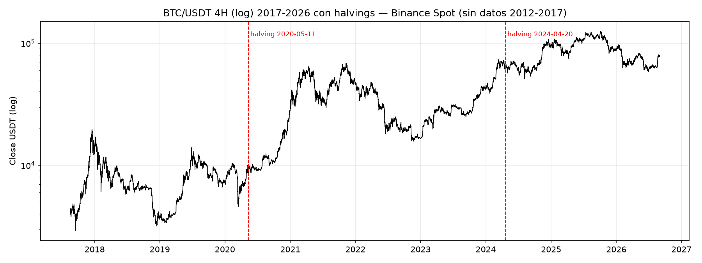

**Figura 1.** Serie de precios 4H (escala log) con los halvings. Se observa la disminución progresiva de la amplitud de
los ciclos coherente con Veloso et al. (2025): el ciclo 2020 multiplica el precio ~×7, mientras el ciclo 2024 apenas ~×1.2.

### 1.2 Estrategias evaluadas

**A. Códigos independientes** (un concepto de trading por código, señales 0/1 long-only):

| Código | Regla | Parámetros (Exp01-TPE80, `configs/strategies.yaml`) |
|---|---|---|
| BH (Only-Buy) | Siempre LONG — benchmark pasivo | — |
| BH+TP 5 % | BH con take-profit 5 % por operación (re-entra tras la venta) | TP = +5 % |
| BH+SL 5 % | BH con stop-loss 5 % por operación | SL = −5 % |
| BH+TP/SL | Gestión de la tesis §6.4: TP +5 % / SL −5 % (relación 1:1) | TP/SL = 5 % |
| RSI | LONG al cruzar el RSI arriba de sobreventa; FLAT si RSI ≥ 50 | periodo 27, OS 41, OB 86 |
| MACD | LONG en cruce alcista MACD/Signal; FLAT en cruce bajista | rápida 30, lenta 46, señal 25 |
| SMA (MA) | LONG si SMA rápida > SMA lenta | 7 / 228 |
| EMA (MA) | LONG si EMA rápida > EMA lenta | 2 / 190 |
| CCI | LONG al cruzar el CCI arriba del nivel de entrada; FLAT sobre el nivel de salida | periodo 39, entrada −64, salida 143 |

**B. Códigos compuestos:**

- **E2-A (CCI + SMA + volumen + ATR)** — la combinación reportada en la literatura (Harsha & Rao, 2024: tendencia +
  volumen + momento) con stop dinámico por volatilidad: la SMA define el régimen de tendencia, el CCI da el momento de
  entrada, el *z-score* de volumen confirma participación, y el stop `entrada − k·ATR` corta la pérdida según la
  volatilidad del activo. Dos variantes: **A1** (parámetros del paper: CCI 20/∓100, SMA 20/50, Vol 20/0.5, ATR 14/2.0) y
  **A2** (parámetros optimizados TPE-150: CCI 58/−3/186, SMA 18/221, Vol 40/0.58, ATR 28/2.44).
- **E2-C (SMA + MACD + RSI)** — combina las ganadoras de la etapa 1 con roles: SMA = régimen, MACD = gatillo, RSI = filtro
  de sobreextensión (SMA 20/150, RSI 14/70, MACD 12/26/9).

### 1.3 Métricas

Retorno total y CAGR netos de costos, Sharpe y Sortino anualizados a 4H (P = 2190 periodos/año, rf = 0),
máximo drawdown (MaxDD), Calmar (CAGR/|MaxDD|), win rate, profit factor, número de operaciones, exposición
(fracción del tiempo en mercado) y turnover. El win rate se calcula sobre periodos con posición abierta.

---

## 2. Resultados de los indicadores independientes

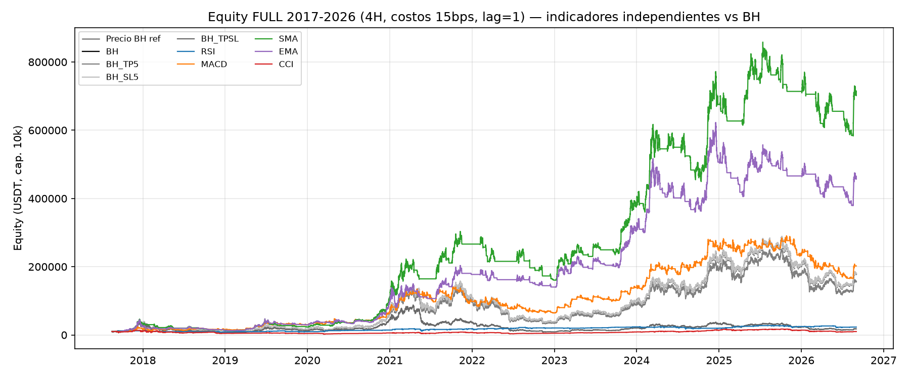

**Figura 2.** Equity FULL 2017–2026 de los códigos independientes (capital 10 000 USDT, costos incluidos).
SMA y EMA se despegan en el bull 2020–2021; RSI/CCI quedan planos; BH+TP/SL se hunde por sobreoperación.

### Tabla 1. Independientes — periodo FULL (2017–2026)

| Estrategia | Equity final | Retorno | CAGR | Sharpe | Sortino | MaxDD | Calmar | Win rate | P. factor | Trades | Expos. |
|---|---:|---:|---:|---:|---:|---:|---:|---:|---:|---:|---:|
| SMA | 702 396 | +6 924 % | **60.05 %** | **1.244** | 1.156 | −73.96 % | 0.812 | 51.41 % | 1.127 | 110 | 0.52 |
| EMA | 457 086 | +4 471 % | 52.62 % | 1.152 | 1.067 | −71.80 % | 0.733 | 50.79 % | 1.117 | 204 | 0.51 |
| MACD | 202 334 | +1 923 % | 39.46 % | 0.960 | 0.911 | −54.17 % | 0.729 | 49.70 % | 1.097 | 304 | 0.50 |
| BH | 177 759 | +1 678 % | 37.48 % | 0.808 | 1.018 | −83.91 % | 0.447 | 51.32 % | 1.059 | 1 | 1.00 |
| BH+SL 5 % | 178 541 | +1 685 % | 37.55 % | 0.808 | 1.020 | −83.91 % | 0.447 | 51.31 % | 1.059 | 6 | 1.00 |
| BH+TP 5 % | 155 409 | +1 454 % | 35.45 % | 0.786 | 0.991 | −83.91 % | 0.423 | 51.16 % | 1.057 | 55 | 1.00 |
| RSI | 23 080 | +131 % | 9.69 % | 0.432 | 0.272 | −47.95 % | 0.202 | 49.16 % | 1.069 | 164 | 0.21 |
| CCI | 9 950 | −0.5 % | −0.06 % | 0.264 | 0.247 | −83.87 % | −0.001 | 50.60 % | 1.026 | 126 | 0.56 |
| BH+TP/SL 5 % | 17 745 | +77 % | 6.55 % | 0.421 | 0.539 | **−90.03 %** | 0.073 | 49.11 % | 1.030 | 819 | 0.96 |

**Interpretación (FULL).** El cruce de medias **SMA(7/228)** domina en rentabilidad absoluta (CAGR 60 % vs 37.5 % del BH)
y en Sharpe (1.244), seguida de la EMA y el MACD: los seguidores de tendencia capturan el drift alcista secular de
Bitcoin. El **RSI** gana poco (CAGR 9.7 %) porque, con umbral de salida en 50, se sale demasiado pronto de las tendencias
fuertes —típico de un oscilador de reversión aplicado a un activo con tendencia. El **CCI aislado** es nulo neto
(−0.5 %): genera señales válidas pero su drawdown (−83.9 %) revela que sin filtro de tendencia queda atrapado en cada
impulso contrario. La gestión **TP/SL 5 %** es la gran lección de riesgo: el TP recorta las colas ganadoras del activo
(BH+TP rinde menos que BH puro), el SL evaluado a cierre de vela 4H casi nunca se activa (BH+SL ≈ BH, solo 6 operaciones
en 9 años), y la combinación TP+SL **destruye valor por sobreoperación**: 819 operaciones, costos acumulados y el peor
drawdown de la muestra (−90 %).

### Resultados por ciclo halving (independientes)

| Ciclo | Lo mejor | Lo peor | Hecho clave |
|---|---|---|---|
| **C16** (2017–2020, bear + recuperación) | **EMA** (Sharpe 1.169, CAGR 65 %) y MACD (1.156) | CCI (−0.191), E2-A A1 (−0.910) | Los cruces rápidos (EMA 2/190) rotan a tiempo en el crash 2018; el BH sufre −83.9 % |
| **C20** (2020–2024, gran bull) | **SMA** (Sharpe **1.745**, CAGR **101.6 %**) | BH+TP/SL (0.539) | Con tendencia fuerte, el seguidor lento maximiza; el TP 5 % deja +563 % sobre la mesa vs BH |
| **C24** (2024–2026, lateral + corrección −53 %) | **SMA** (0.520) apenas supera al BH (0.403) | RSI (0.098), CCI (0.123) | Sin tendencia, **ningún independiente brilla**: los osciladores dan Sharpe ≈ 0 y el MACD solo 0.215 |

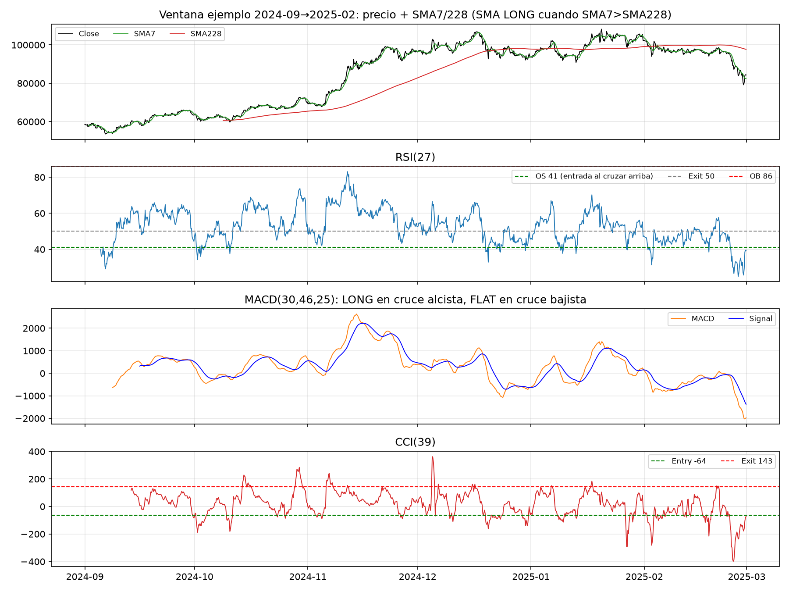

**Figura 3.** Ventana 2024-09→2025-02 con los cuatro indicadores y sus umbrales: se aprecia por qué el RSI (salida en 50)
y el CCI (salida en 143) se quedan fuera de los tramos tendenciales que sí capturan las medias móviles.

---

## 3. Resultados de las estrategias compuestas

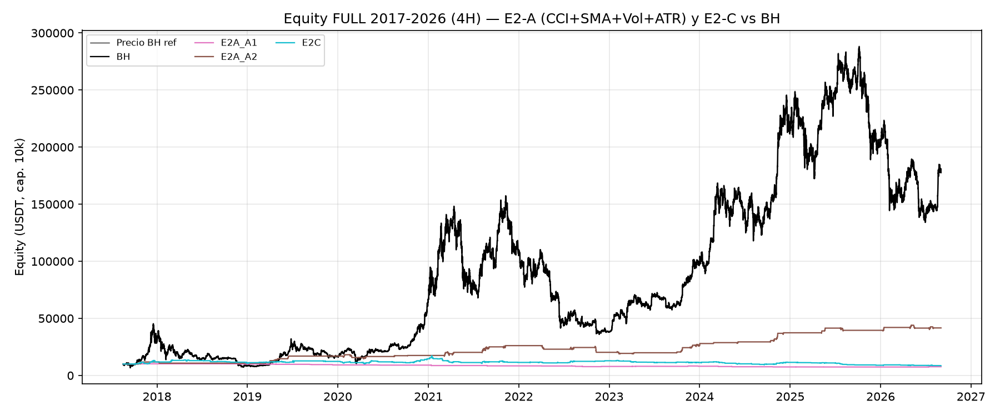

**Figura 4.** Equity FULL de E2-A (A1 paper, A2 optimizada) y E2-C frente al BH. La curva negra del BH es el precio
escalado; las compuestas operan una fracción pequeña del tiempo (exposición 1–10 %) y por eso su equity es
visualmente plano frente al BH, **pero con caídas máximas 3× menores** (ver Figura 7).

### Tabla 2. Compuestas — periodo FULL

| Estrategia | Equity final | Retorno | CAGR | Sharpe | MaxDD | Calmar | Win rate | P. factor | Trades | Expos. |
|---|---:|---:|---:|---:|---:|---:|---:|---:|---:|---:|---:|
| **E2-A A2 (optimizada)** | 41 621 | +316 % | 17.08 % | **1.144** | **−27.93 %** | 0.612 | **53.27 %** | **1.277** | 39 | 0.09 |
| E2-C (SMA+MACD+RSI) | 8 494 | −15.1 % | −1.79 % | −0.024 | −51.08 % | −0.035 | 42.31 % | 0.995 | 294 | 0.10 |
| E2-A A1 (paper) | 7 649 | −23.5 % | −2.92 % | −0.609 | −28.83 % | −0.101 | 35.93 % | 0.682 | 30 | 0.01 |

**Interpretación.** Hay tres noticias, una buena, una mala y una decisiva:

1. **La mala:** los parámetros "de libro" **no funcionan en Bitcoin**: E2-A A1 pierde −23.5 % y E2-C pierde −15.1 % en
   FULL. E2-C opera 294 veces con win rate de apenas 42 %: exigir régimen + gatillo + filtro simultáneos deja pasar
   las tendencias buenas y concentra operaciones en ruido lateral. Esto confirma lo advertido en el marco teórico:
   los parámetros tradicionales no son trasladables a criptoactivos.
2. **La buena:** la **misma arquitectura E2-A con parámetros optimizados (A2)** pasa de Sharpe −0.61 a **+1.14**,
   con el **mejor profit factor de todo el estudio (1.277)**, el mejor win rate (53.3 %) y un MaxDD de solo −27.9 %
   frente al −83.9 % del BH. El stop ATR dinámico cumple su función: corta por volatilidad, no por porcentaje fijo.
3. **La decisiva (robustez por ciclos):**

### Tabla 3. E2-A A2 vs referentes, por ciclo halving

| Periodo | E2-A A2 (Sharpe / CAGR / MaxDD) | SMA | BH |
|---|---|---|---|
| C16 | **1.257** / 20.4 % / **−19.6 %** | 1.071 / 57.3 % / −74.0 % | 0.730 / 29.0 % / −83.9 % |
| C20 | 0.920 / 15.0 % / **−27.9 %** | **1.745** / 101.6 % / −47.2 % | 1.115 / 65.7 % / −77.0 % |
| C24 | **1.768** / 16.9 % / **−8.8 %** | 0.520 / 11.3 % / −32.1 % | 0.403 / 8.3 % / −53.5 % |

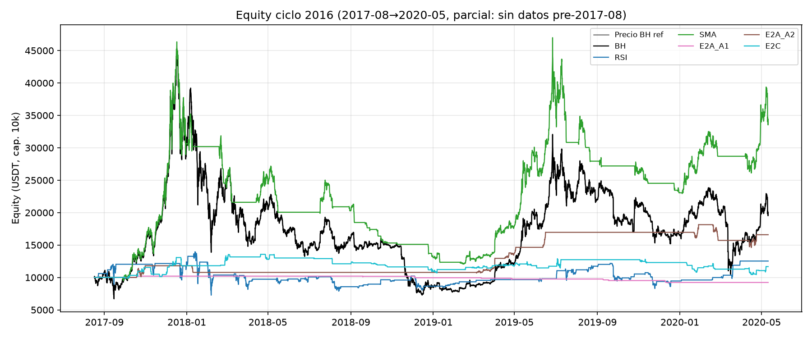
**Figura 5a.** Ciclo 2016 (parcial): E2-A A2 lidera en Sharpe con solo 9 operaciones y MaxDD −19.6 %.

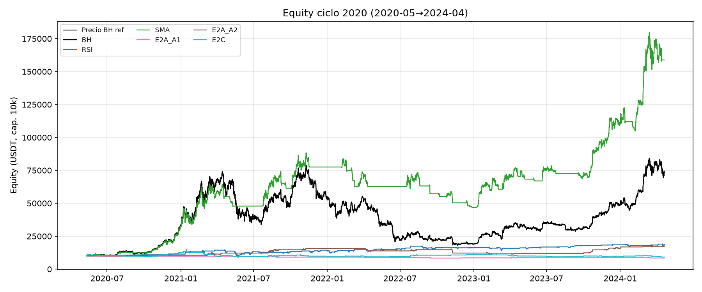
**Figura 5b.** Ciclo 2020: el BH y la SMA vuelan con el bull market; E2-A A2 gana menos pero sin el crash de 2022 en su equity.

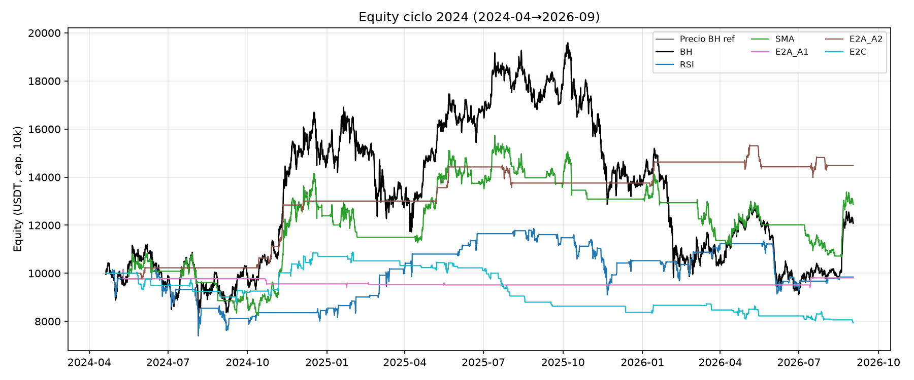
**Figura 5c.** Ciclo 2024 (el examen difícil): mercado lateral con corrección del −53 % en el BH; **solo E2-A A2
entrega Sharpe 1.77 con MaxDD de un dígito (−8.8 %)**. Es la única estrategia rentable y estable en los tres ciclos.

---

## 4. Comparativa riesgo–rendimiento e interpretación global

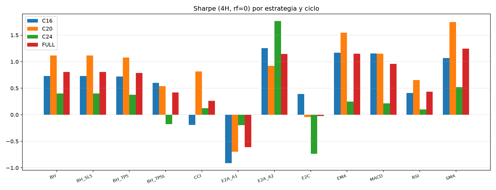
**Figura 6.** Sharpe por estrategia y ciclo. Patrón estructural: los seguidores de tendencia (SMA/EMA/MACD) dominan en
ciclos tendenciales (C16, C20) y se desinflan en el lateral (C24); **E2-A A2 es la única barra positiva y alta en los
tres ciclos**, con pico en C24.

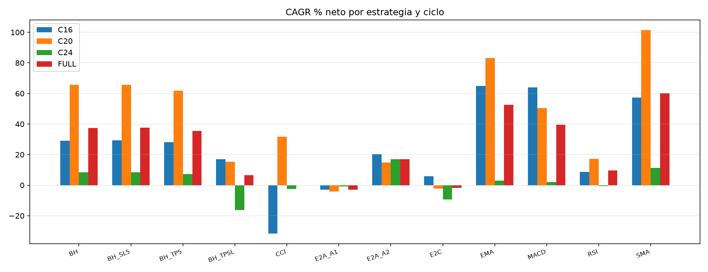
**Figura 7.** CAGR neto: el BH y la SMA maximizan retorno absoluto a costa de riesgo extremo (ver Figura 8).

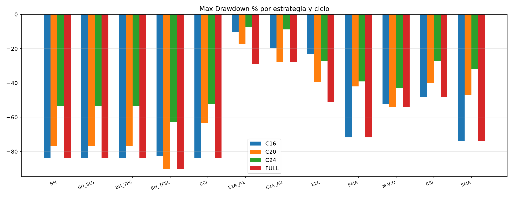
**Figura 8.** MaxDD: BH y TP/SL tocan −84 %/−90 %; E2-A A2 nunca supera −28 % en ningún periodo.

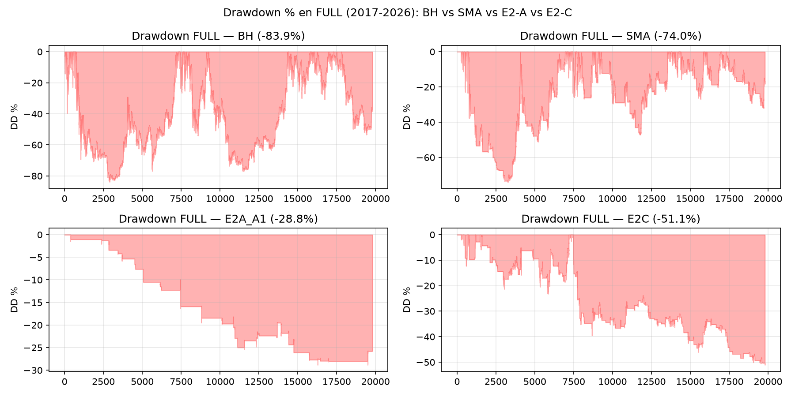
**Figura 9.** Drawdown % en FULL: el BH pasa años bajo el agua (−83.9 %); la SMA también (−74 %); **E2-A A2 (eje propio
implícito: mínimo −27.9 %) es la única curva compatible con gestión profesional del riesgo**, a cambio de 39
operaciones en 9 años (selectividad extrema, exposición 9 %).

### 4.1 Lectura riesgo–rendimiento (criterio del objetivo general)

1. **Rentabilidad absoluta:** SMA (CAGR 60 %) > EMA (52.6 %) > MACD (39.5 %) > BH (37.5 %) > E2-A A2 (17.1 %).
   Si el único criterio fuera retorno, ganaría la SMA.
2. **Riesgo:** E2-A A2 (MaxDD −27.9 %, Calmar 0.61, PF 1.28) ≫ MACD (Calmar 0.73 pero MaxDD −54 %) > SMA (MaxDD −74 %) >
   BH (−84 %) > TP/SL (−90 %). En el ratio **Calmar** la SMA (0.81) supera a E2-A A2 (0.61) en FULL, **pero colapsa en
   C24 (0.35 vs 1.92 de E2-A A2)**: la SMA no es robusta entre regímenes.
3. **Robustez entre ciclos (criterio decisivo):** solo **E2-A A2 tiene Sharpe positivo en C16, C20, C24 y FULL**,
   con drawdown siempre inferior al −28 %. Ninguna otra estrategia —ni el BH— lo logra.
4. **Costos y operatividad:** E2-A A2 ejecuta 39 operaciones en 9 años (~4/año): los costos (15 bps por lado) son
   irrelevantes y la estrategia es operable manualmente en 4H. La SMA (110) y el MACD (304) pagan 5–15× más costos;
   el TP/SL 5 % (819) se autodestruye en comisiones y latigazos.

### 4.2 Selección: la estrategia con mejor desempeño riesgo–rendimiento

> **Se selecciona la estrategia compuesta E2-A optimizada (CCI + SMA + volumen + stop ATR dinámico, variante A2)**
> como la de mejor desempeño en términos de riesgo–rendimiento: Sharpe FULL 1.144 (2.º global tras la SMA),
> MaxDD −27.9 % (el menor entre las rentables), profit factor 1.277 (el mayor del estudio), win rate 53.3 % y,
> sobre todo, **consistencia positiva en los tres ciclos halving**, incluido el régimen lateral C24 donde todo lo
> demás colapsa. La SMA queda como segunda (mejor retorno absoluto para perfiles tolerantes al riesgo) y el
> Buy & Hold como benchmark superado en Sharpe (0.81) y en drawdown por ambas.

Esta selección responde directamente a los objetivos específicos 2 y 3 (selección por riesgo–rendimiento y evaluación
por backtesting en distintos regímenes) y deja habilitado el objetivo 4: la variante A2 ya es producto de
optimización (TPE-150); el paso pendiente es el **PSO** propuesto en §6.5 con función `Sharpe·(1−MaxDD)` y su
validación out-of-sample 2025–2026 + prueba de significancia vs BH.

---

## 5. Limitaciones y trabajo futuro

1. **Ciclos 2012 y 2016 incompletos:** Binance BTCUSDT nace el 2017-08-17; no existe test homogéneo pre-2017 con esta
   fuente. El C16 reportado es parcial y debe citarse así.
2. **Timeframe único (4H):** los parámetros EXP01/A2 están sintonizados a 4H; la sensibilidad a 1H/1D queda pendiente.
3. **Stop fijo evaluado a cierre:** el SL 5 % a cierre de vela subestima la protección intradiaria real; un backtester
   con high/low intra-vela (o tick) es mejora natural.
4. **Sin short ni apalancamiento:** diseño long-only fiel a la tesis; en el bear 2022 toda estrategia long sufre por
   construcción.
5. **Siguiente paso:** PSO sobre E2-A (espacio expandido: la A2 quedó en bordes, ver `docs/experimento_02_plan.md`),
   forward testing OOS 2025–2026 y test de hipótesis de retornos vs Buy & Hold (§6.6).

## 6. Reproducibilidad

```bash
pip install -r requirements.txt
$env:PYTHONPATH="E:\bitcoin-trading-research"   # PowerShell
python scripts/run_tesis_resultados.py          # regenera tablas/*.csv y figs/*.png
```

Motor: `src/backtesting/engine.py` (lag = 1, fee 10 bps + slippage 5 bps) · Señales: `src/strategies/`
(RSI/MACD/SMA/EMA/CCI en `individuals.py` con `EXP01_BEST`; E2-A en `e2a_composite.py` con `E2A_A1`/`E2A_A2_BEST`;
E2-C en `e2c_winners.py`; BH en `buy_and_hold.py`) · Datos: `data/processed/btcusdt_1m.parquet` → resample 4H
(`data/processed/btcusdt_4h.parquet`, 19 800 velas).

*Documento generado el 2026-09-08 a partir de la ejecución real del código — ninguna cifra es ilustrativa.*
