# CAPÍTULO DE RESULTADOS v2 — Backtest 70 %, forward 30 %, temporadas por halving y optimización PSO

**Trabajo de grado — Ingeniería Financiera, UNAB.**
**Autores:** Javier Antonio Reyes Espinosa, Juan David Ramírez Castilla · **Asesor:** José Luis Flórez Rueda.
**Activo:** BTC/USDT spot (Binance) · **Temporalidad:** velas de 4 horas · **Capital inicial:** 10 000 USDT ·
**Costos:** fee 0.10 % + slippage 5 bps por lado (15 bps por lado) · **Ejecución:** lag = 1 vela (sin look-ahead) ·
**Posición:** exclusivamente en largo (long-only, sin apalancamiento, sin cortos).

> **Cómo leer este documento (v2).** Todo sigue un orden de pasos, y cada porcentaje lleva su periodo exacto
> (p. ej. "+60.71 % entre 2023-12-17 y 2026-09-01"): ningún número aparece sin su ventana temporal.
> La Sección 1 explica **qué se hizo, paso a paso** (datos → división 70/30 → temporadas → estrategias →
> métricas → optimización). La Sección 2 muestra el **backtest con el 70 % inicial** (donde se selecciona y se
> optimiza). La Sección 3 muestra **cómo se comportó cada estrategia en el 30 % restante no visto** (forward).
> La Sección 4 presenta las **temporadas por halving** (ganancia y Sharpe por temporada, con tabla y gráfica).
> La Sección 5 describe la **optimización, únicamente por Enjambre de Partículas (PSO)**. La Sección 6 compara
> todo en riesgo–rendimiento y **selecciona la mejor estrategia**. Todas las cifras provienen de la ejecución
> real de `scripts/run_tesis_resultados_v2.py`; tablas fuente en `tablas/metricas_por_periodo_v2.csv`.
> La v1 (`docs/tesis_resultados/`) no se modifica.

---

## 1. Qué se hizo: el protocolo en 6 pasos

### Paso 1 — Datos (con qué se hace el backtest)

Fuente homogénea única: **Binance Data Vision, par BTCUSDT spot**, consolidado en
`data/processed/btcusdt_1m.parquet` y remuestreado a **4H** (`data/processed/btcusdt_4h.parquet`):
**19 800 velas de 4H desde 2017-08-17 04:00 UTC hasta 2026-09-01 20:00 UTC (~9.04 años)**.
Los halvings ocurrieron el 2012-11-28, 2016-07-09, 2020-05-11 y 2024-04-20; como Binance solo existe
desde 2017-08-17, los ciclos 2012 y 2016 no son testeables completos con esta fuente (empalmar otra fuente
rompería la homogeneidad de microstructure y comisiones), por lo que el ciclo 2016 se reporta como parcial.

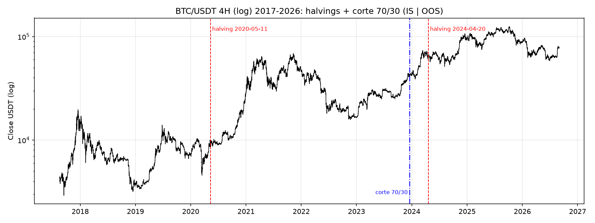

**Figura 1.** Serie de precios 4H (escala log) con halvings (líneas rojas) y corte 70/30 (línea azul:
izquierda = in-sample, derecha = forward no visto). Se aprecia la maduración del mercado: el ciclo 2020
multiplica el precio ~×7 y el ciclo 2024 apenas ~×1.2 con una corrección del −53 % en el BH.

### Paso 2 — División 70/30 (cronológica, sin shuffle)

El corte es determinista por índice (70 % de 19 800 = 13 860 velas), sin aleatoriedad ni fuga de información:

| Bloque | Ventana exacta | Velas 4H | Uso |
|---|---|---:|---|
| **IS70 (in-sample, 70 %)** | 2017-08-17 → 2023-12-16 | 13 860 | Backtest, selección y optimización PSO |
| **OOS30 (forward, 30 % restante)** | 2023-12-17 → 2026-09-01 | 5 940 | Validación con datos no vistos (nunca optimizados aquí) |
| FULL (referencia) | 2017-08-17 → 2026-09-01 | 19 800 | Contexto total, no se usa para seleccionar |

### Paso 3 — Temporadas por halving (ventanas fijas)

| Temporada | Ventana testeada | Velas 4H | Lectura |
|---|---|---:|---|
| C16 | 2017-08-17 → 2020-05-10 | 5 970 | Cola del ciclo del halving 2016 (parcial: sin datos previos) |
| C20 | 2020-05-11 → 2024-04-19 | 8 640 | Ciclo 2020 completo (bull 2020–2021 + bear 2022) |
| C24 | 2024-04-20 → 2026-09-01 | 5 190 | Ciclo 2024 (lateral/alcista suave con corrección −53 % en BH) |

### Paso 4 — Estrategias (9 independientes + 4 compuestas = 13)

Todas generan señales 0/1 long-only, ejecutadas con lag = 1 vela.

**A. Independientes** (un concepto de trading por código):

| Código | Regla | Parámetros |
|---|---|---|
| BH | Siempre LONG — benchmark pasivo | — |
| BH+TP 5 % | BH con take-profit 5 % por operación (re-entra tras la venta) | TP = +5 % |
| BH+SL 5 % | BH con stop-loss 5 % por operación | SL = −5 % |
| BH+TP/SL | TP +5 % / SL −5 % (relación 1:1) | TP/SL = 5 % |
| RSI | LONG al cruzar el RSI arriba de sobreventa; FLAT si RSI ≥ 50 | periodo 27, OS 41, OB 86 |
| MACD | LONG en cruce alcista MACD/Signal; FLAT en cruce bajista | rápida 30, lenta 46, señal 25 |
| SMA | LONG si SMA rápida > SMA lenta | 7 / 228 |
| EMA | LONG si EMA rápida > EMA lenta | 2 / 190 |
| CCI | LONG al cruzar el CCI arriba del nivel de entrada; FLAT sobre la salida | periodo 39, entrada −64, salida 143 |

**B. Compuestas:**

- **E2-A (CCI + SMA + volumen + ATR):** la SMA define el régimen de tendencia, el CCI da el momento de
  entrada, el *z-score* de volumen confirma participación. Tres variantes: **A1** (parámetros de libro:
  CCI 20/∓100, SMA 20/50, Vol 20/0.5, ATR 14/2.0), **A2** (referencia: CCI 58/−3/186, SMA 18/221,
  Vol 40/0.58, ATR 28/2.44) y **PSO** (optimizada en esta v2, ver §5: CCI 10/50/250, SMA 27/227, Vol 60/0.14).
- **E2-C (SMA + MACD + RSI):** SMA = régimen, MACD = gatillo, RSI = filtro de sobreextensión
  (SMA 20/150, RSI 14/70, MACD 12/26/9).

### Paso 5 — Métricas (qué significa cada columna de las tablas)

Retorno total y CAGR netos de costos; Sharpe y Sortino anualizados a 4H (P = 2190 periodos/año, rf = 0);
máximo drawdown (MaxDD, peor caída pico–valle); Calmar (CAGR/|MaxDD|); win rate (sobre periodos con
posición abierta); profit factor (ganancia bruta / pérdida bruta); operaciones (entradas); exposición
(fracción del tiempo en mercado); turnover (giro acumulado). Motor: `src/backtesting/engine.py`.

### Paso 6 — Optimización (solo PSO, detalle en §5)

El único optimizador de esta versión es el **Enjambre de Partículas (PSO)**: 12 partículas × 20 iteraciones
sobre el IS70 con objetivo Sharpe, semilla 42. Produce la variante E2-A PSO, evaluada después en el 30 %
no visto y en cada temporada.

---

## 2. Backtest con el 70 % inicial (IS70: 2017-08-17 → 2023-12-16, 13 860 velas)

**Este es el bloque con el que se hace el backtest y la optimización.** La selección de la estrategia se
decide aquí; el 30 % restante (§3) solo valida, sin re-optimizar.

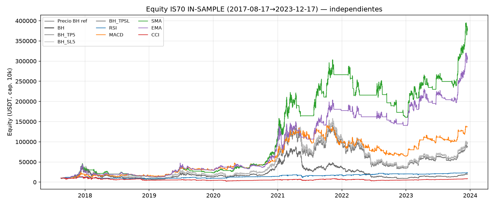

**Figura 2a.** Equity IS70 de los independientes (2017-08-17 → 2023-12-16, capital 10 000 USDT, costos
incluidos). SMA y EMA se despegan en el bull 2020–2021; RSI/CCI quedan planos; BH+TP/SL se hunde por
sobreoperación.

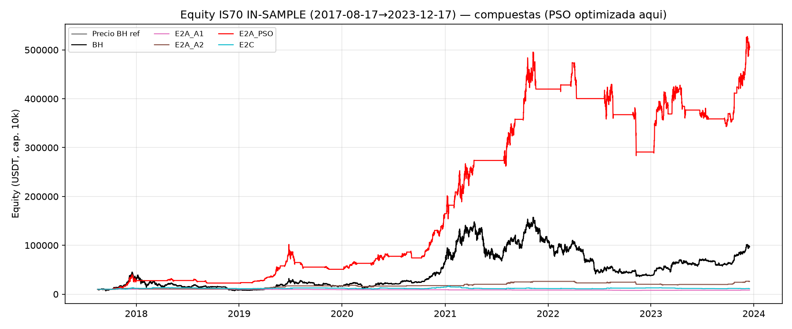

**Figura 2b.** Equity IS70 de las compuestas. E2-A PSO lidera; E2-A A2 avanza plana con caídas pequeñas;
E2-A A1 y E2-C pierden.

### Tabla 1a. Backtest IS70 — independientes (2017-08-17 → 2023-12-16)

| Estrategia | Equity final | Retorno | CAGR | Sharpe | MaxDD | Calmar | Win rate | P. factor | Trades | Expos. |
|---|---:|---:|---:|---:|---:|---:|---:|---:|---:|---:|
| SMA | 377 904 | +3 679.04 % | 77.52 % | 1.369 | −73.96 % | 1.048 | 52.07 % | 1.140 | 72 | 0.51 |
| EMA | 306 364 | +2 963.64 % | 71.73 % | 1.320 | −71.80 % | 0.999 | 51.48 % | 1.136 | 132 | 0.51 |
| MACD | 137 214 | +1 272.13 % | 51.26 % | 1.076 | −54.17 % | 0.946 | 50.23 % | 1.109 | 208 | 0.51 |
| BH | 97 048 | +870.48 % | 43.20 % | 0.853 | −83.91 % | 0.515 | 51.50 % | 1.062 | 1 | 1.00 |
| BH+SL 5 % | 97 475 | +874.75 % | 43.30 % | 0.854 | −83.91 % | 0.516 | 51.48 % | 1.062 | 6 | 1.00 |
| BH+TP 5 % | 88 004 | +780.04 % | 41.01 % | 0.832 | −83.91 % | 0.489 | 51.31 % | 1.061 | 44 | 1.00 |
| RSI | 23 695 | +136.95 % | 14.60 % | 0.534 | −47.95 % | 0.305 | 49.40 % | 1.087 | 116 | 0.21 |
| BH+TP/SL 5 % | 20 170 | +101.70 % | 11.72 % | 0.511 | −90.03 % | 0.130 | 49.03 % | 1.037 | 664 | 0.95 |
| CCI | 8 442 | −15.58 % | −2.64 % | 0.247 | −83.87 % | −0.031 | 50.59 % | 1.025 | 89 | 0.53 |

### Tabla 1b. Backtest IS70 — compuestas (2017-08-17 → 2023-12-16)

| Estrategia | Equity final | Retorno | CAGR | Sharpe | MaxDD | Calmar | Win rate | P. factor | Trades | Expos. |
|---|---:|---:|---:|---:|---:|---:|---:|---:|---:|---:|
| **BH (benchmark)** | 97 048 | +870.48 % | 43.20 % | 0.853 | −83.91 % | 0.515 | 51.50 % | 1.062 | 1 | 1.00 |
| **E2-A PSO** | 504 471 | **+4 944.71 %** | 85.81 % | **1.616** | −50.34 % | 1.705 | 52.94 % | 1.198 | 47 | 0.38 |
| E2-A A2 | 26 076 | +160.76 % | 16.35 % | 1.006 | −27.93 % | 0.585 | 54.03 % | 1.232 | 25 | 0.10 |
| E2-C | 11 243 | +12.43 % | 1.87 % | 0.193 | −39.54 % | 0.047 | 43.44 % | 1.040 | 205 | 0.10 |
| E2-A A1 | 8 296 | −17.04 % | −2.91 % | −0.579 | −25.41 % | −0.114 | 34.16 % | 0.698 | 22 | 0.01 |

**Interpretación del backtest (IS70).**
1. **Seguidores de tendencia mandan en-sample:** SMA (+3 679.04 %, Sharpe 1.369), EMA (+2 963.64 %, 1.320) y
   MACD (+1 272.13 %, 1.076) capturan el drift alcista 2017–2023; el PSO los supera a todos (+4 944.71 %,
   Sharpe 1.616, ver §5).
2. **La gestión TP/SL 5 % destruye valor:** el TP recorta las colas ganadoras (BH+TP +780.04 % < BH +870.48 %),
   el SL a cierre de vela 4H casi nunca se activa (BH+SL ≈ BH, 6 operaciones en 6.33 años) y la combinación
   TP+SL opera 664 veces con el peor drawdown (−90.03 %).
3. **Osciladores aislados, tibios o nulos:** el RSI gana poco (+136.95 %) porque su salida en 50 lo saca pronto
   de las tendencias; el CCI pierde (−15.58 %) sin filtro de tendencia.
4. **Compuestas:** los parámetros "de libro" no funcionan en Bitcoin (E2-A A1 −17.04 % con win rate de apenas
   34.16 %); E2-C es marginal (+12.43 %, Sharpe 0.193, 205 operaciones); la misma arquitectura E2-A con
   parámetros PSO pasa a Sharpe 1.616 con profit factor 1.198 y MaxDD −50.34 %.

---

## 3. El 30 % restante no visto (OOS30 forward: 2023-12-17 → 2026-09-01, 5 940 velas)

**Ningún parámetro se tocó con estos datos.** Es la prueba honesta de robustez: qué pasó cuando cada
estrategia enfrentó 2.71 años nuevos (régimen lateral/alcista con la corrección 2024–2026).

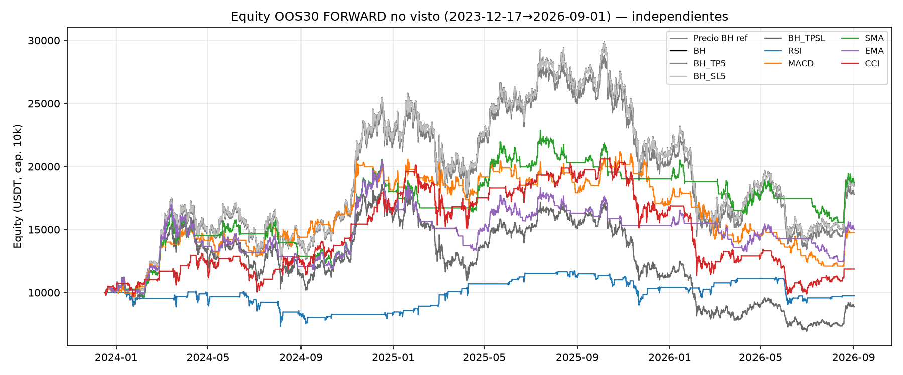

**Figura 3a.** Equity forward de los independientes (2023-12-17 → 2026-09-01). SMA y BH avanzan con
serruchos profundos; MACD/EMA ganan menos; RSI queda plano; CCI apenas se salva; E2-C pierde.

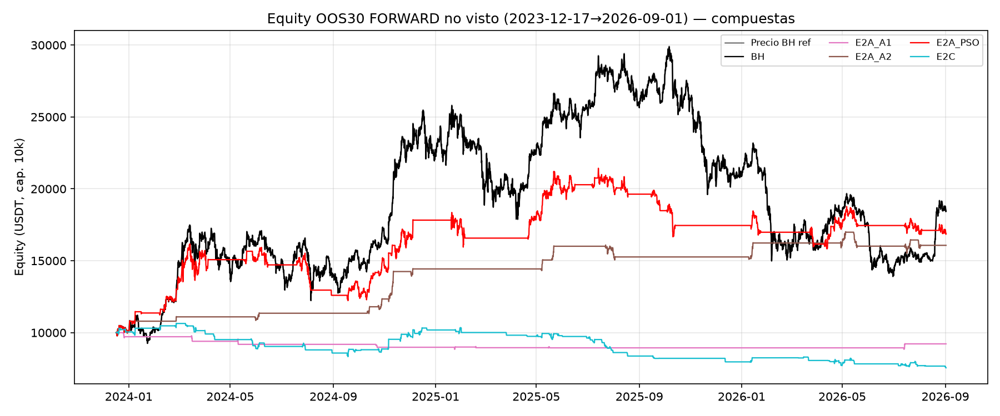

**Figura 3b.** Equity forward de las compuestas (2023-12-17 → 2026-09-01). E2-A A2 sube estable con caídas
de un dígito; E2-A PSO gana pero con más serrucho; E2-A A1 y E2-C pierden.

### Tabla 2a. Forward OOS30 — independientes (2023-12-17 → 2026-09-01)

| Estrategia | Equity final | Retorno | CAGR | Sharpe | MaxDD | Calmar | Win rate | P. factor | Trades | Expos. |
|---|---:|---:|---:|---:|---:|---:|---:|---:|---:|---:|
| SMA | 18 715 | +87.15 % | 25.99 % | 0.895 | −32.06 % | 0.811 | 49.95 % | 1.081 | 39 | 0.53 |
| BH | 18 443 | +84.43 % | 25.32 % | 0.717 | −53.45 % | 0.474 | 50.92 % | 1.047 | 1 | 1.00 |
| BH+SL 5 % | 18 443 | +84.43 % | 25.32 % | 0.717 | −53.45 % | 0.474 | 50.92 % | 1.047 | 1 | 1.00 |
| BH+TP 5 % | 17 781 | +77.81 % | 23.64 % | 0.689 | −53.45 % | 0.442 | 50.80 % | 1.045 | 12 | 1.00 |
| EMA | 15 023 | +50.23 % | 16.19 % | 0.636 | −39.17 % | 0.413 | 49.29 % | 1.057 | 73 | 0.53 |
| MACD | 14 746 | +47.46 % | 15.40 % | 0.613 | −43.06 % | 0.358 | 48.41 % | 1.057 | 96 | 0.49 |
| CCI | 11 868 | +18.68 % | 6.52 % | 0.356 | −52.41 % | 0.124 | 50.64 % | 1.029 | 38 | 0.62 |
| BH+TP/SL 5 % | 8 859 | −11.41 % | −4.37 % | 0.131 | −62.75 % | −0.070 | 49.32 % | 1.008 | 156 | 0.97 |
| RSI | 9 740 | −2.60 % | −0.97 % | 0.087 | −27.74 % | −0.035 | 48.63 % | 1.012 | 48 | 0.23 |

### Tabla 2b. Forward OOS30 — compuestas (2023-12-17 → 2026-09-01)

| Estrategia | Equity final | Retorno | CAGR | Sharpe | MaxDD | Calmar | Win rate | P. factor | Trades | Expos. |
|---|---:|---:|---:|---:|---:|---:|---:|---:|---:|---:|
| **BH (benchmark)** | 18 443 | +84.43 % | 25.32 % | 0.717 | −53.45 % | 0.474 | 50.92 % | 1.047 | 1 | 1.00 |
| **E2-A A2** | 16 071 | **+60.71 %** | 19.12 % | **1.816** | **−8.82 %** | 2.168 | 51.23 % | 1.484 | 15 | 0.08 |
| E2-A PSO | 16 868 | +68.68 % | 21.26 % | 0.847 | −26.14 % | 0.813 | 50.11 % | 1.089 | 27 | 0.40 |
| E2-A A1 | 9 220 | −7.80 % | −2.95 % | −0.699 | −11.58 % | −0.255 | 40.00 % | 0.636 | 8 | 0.01 |
| E2-C | 7 555 | −24.45 % | −9.82 % | −0.745 | −29.09 % | −0.338 | 39.61 % | 0.861 | 89 | 0.10 |

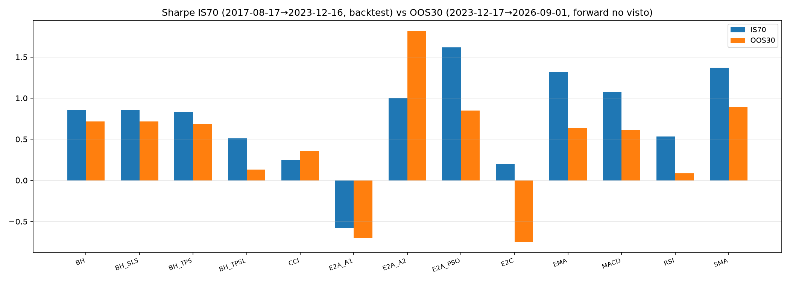

**Figura 3c.** Sharpe en backtest (IS70: 2017-08-17 → 2023-12-16) vs forward no visto (OOS30: 2023-12-17 →
2026-09-01), estrategia por estrategia. E2-A A2 es la única que **mejora** fuera de muestra (1.006 → 1.816);
el PSO se degrada a la mitad (1.616 → 0.847); SMA/EMA/MACD caen; RSI y E2-C colapsan a ~0 o negativo.

**Interpretación del forward (OOS30) — el resultado clave de la v2.**
1. **E2-A A2 generaliza mejor en riesgo–rendimiento:** Sharpe 1.816 con MaxDD de un dígito (−8.82 %) y
   +60.71 % de retorno entre 2023-12-17 y 2026-09-01, con solo 15 operaciones y 8 % de exposición. Es la
   única curva compatible con gestión profesional del riesgo en el forward.
2. **SMA y BH ganan más en absoluto** (+87.15 % y +84.43 % entre 2023-12-17 y 2026-09-01) **pero con 3–6× más
   riesgo** (MaxDD −32.06 % y −53.45 %, Sharpe 0.895 y 0.717). El SL 5 % sigue sin activarse (BH+SL = BH).
3. **E2-A PSO sufre degradación parcial fuera de muestra:** +68.68 % con Sharpe 0.847 (frente a 1.616 en IS).
   Sigue rentable y positiva, pero el Sharpe forward es menos de la mitad del in-sample: señal de sobreajuste
   parcial a 2017–2023 (ver §5).
4. **Se descartan:** E2-C (−24.45 %, Sharpe −0.745, 89 operaciones), E2-A A1 (−7.80 %, win rate 40 %) y
   BH+TP/SL (−11.41 % con 156 operaciones y MaxDD −62.75 %). El RSI (−2.60 %) y el CCI (+18.68 % con MaxDD
   −52.41 %) no compensan su riesgo.

---

## 4. Temporadas por halving: ganancia y Sharpe por temporada

### Tabla 3. Temporada C16 — cola del ciclo 2016 (2017-08-17 → 2020-05-10, 5 970 velas)

| Estrategia | Retorno (2017-08-17 → 2020-05-10) | Sharpe | CAGR | MaxDD | Trades |
|---|---:|---:|---:|---:|---:|
| **E2-A PSO** | **+603.96 %** | **1.634** | 104.60 % | −50.34 % | 19 |
| E2-A A2 | +65.88 % | 1.257 | 20.40 % | −19.60 % | 9 |
| EMA | +291.69 % | 1.169 | 65.01 % | −71.80 % | 57 |
| MACD | +285.72 % | 1.156 | 64.08 % | −52.30 % | 81 |
| SMA | +243.94 % | 1.071 | 57.33 % | −73.96 % | 31 |
| BH+SL 5 % | +101.11 % | 0.731 | 29.21 % | −83.91 % | 6 |
| BH | +100.23 % | 0.730 | 29.01 % | −83.91 % | 1 |
| BH+TP 5 % | +96.80 % | 0.722 | 28.19 % | −83.91 % | 24 |
| BH+TP/SL 5 % | +53.79 % | 0.601 | 17.10 % | −82.64 % | 355 |
| RSI | +25.31 % | 0.410 | 8.63 % | −47.95 % | 51 |
| E2-C | +16.76 % | 0.389 | 5.85 % | −23.18 % | 88 |
| CCI | −64.44 % | −0.191 | −31.56 % | −83.87 % | 32 |
| E2-A A1 | −7.76 % | −0.910 | −2.92 % | −10.51 % | 8 |

En C16 (bear 2018 + recuperación) el PSO lidera ganancia (+603.96 %) y Sharpe (1.634); los cruces rápidos
EMA/MACD rotan a tiempo en el crash; E2-A A2 firma el menor drawdown (−19.60 %); el BH sufre −83.91 %; el
CCI (−64.44 %) y E2-A A1 (−7.76 %) pierden.

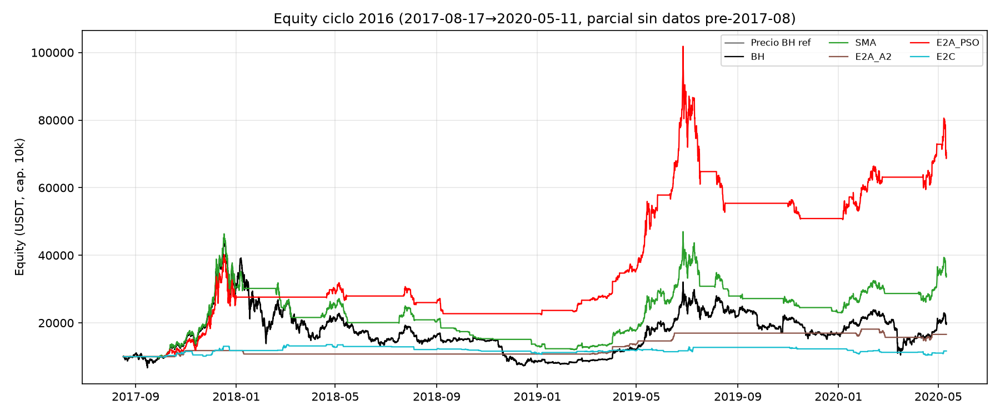

**Figura 4a.** Equity C16 (2017-08-17 → 2020-05-10, parcial: sin datos pre-2017-08).

### Tabla 4. Temporada C20 — ciclo 2020 completo (2020-05-11 → 2024-04-19, 8 640 velas)

| Estrategia | Retorno (2020-05-11 → 2024-04-19) | Sharpe | CAGR | MaxDD | Trades |
|---|---:|---:|---:|---:|---:|
| **E2-A PSO** | +974.62 % | **1.770** | 82.56 % | −42.81 % | 34 |
| SMA | **+1 488.32 %** | 1.745 | 101.56 % | −47.16 % | 46 |
| EMA | +989.41 % | 1.545 | 83.19 % | −41.97 % | 85 |
| MACD | +399.55 % | 1.151 | 50.34 % | −54.17 % | 140 |
| BH | +632.72 % | 1.115 | 65.67 % | −77.04 % | 1 |
| BH+SL 5 % | +632.72 % | 1.115 | 65.67 % | −77.04 % | 1 |
| BH+TP 5 % | +569.11 % | 1.079 | 61.90 % | −77.00 % | 22 |
| E2-A A2 | +73.26 % | 0.920 | 14.95 % | −27.93 % | 17 |
| CCI | +195.46 % | 0.817 | 31.60 % | −63.17 % | 63 |
| RSI | +87.12 % | 0.653 | 17.21 % | −39.84 % | 69 |
| BH+TP/SL 5 % | +75.74 % | 0.539 | 15.36 % | −90.03 % | 339 |
| E2-C | −8.36 % | −0.045 | −2.19 % | −39.54 % | 134 |
| E2-A A1 | −15.47 % | −0.695 | −4.17 % | −17.19 % | 16 |

En el gran bull C20 la SMA maximiza ganancia (+1 488.32 % entre 2020-05-11 y 2024-04-19) y el PSO el Sharpe
(1.770) con +974.62 %. El TP 5 % deja +63 puntos sobre la mesa vs BH (+569.11 % vs +632.72 %). E2-C pierde
(−8.36 %) operando 134 veces en ruido y E2-A A1 también (−15.47 %).

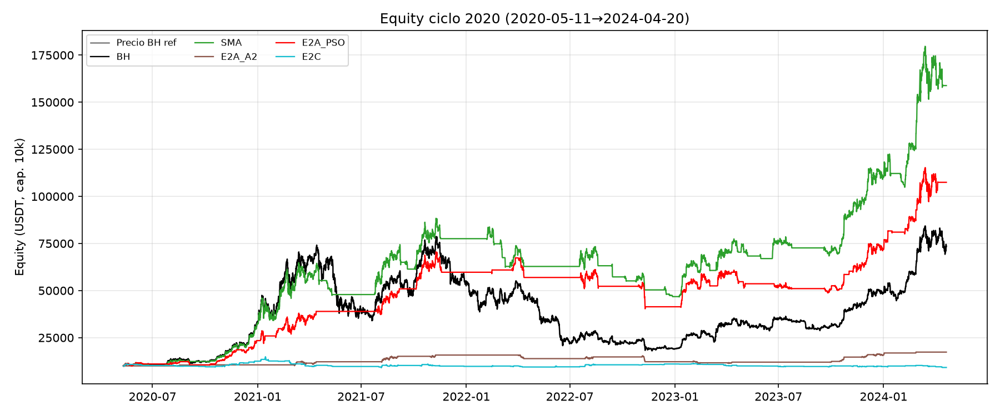

**Figura 4b.** Equity C20 (2020-05-11 → 2024-04-19): BH y SMA vuelan con el bull; las E2-A ganan menos pero
sin el crash de 2022 en su equity.

### Tabla 5. Temporada C24 — ciclo 2024 (2024-04-20 → 2026-09-01, 5 190 velas, el examen difícil)

| Estrategia | Retorno (2024-04-20 → 2026-09-01) | Sharpe | CAGR | MaxDD | Trades |
|---|---:|---:|---:|---:|---:|
| **E2-A A2** | **+44.82 %** | **1.768** | 16.91 % | **−8.82 %** | 13 |
| SMA | +28.77 % | 0.520 | 11.26 % | −32.06 % | 34 |
| BH | +20.90 % | 0.403 | 8.34 % | −53.45 % | 1 |
| BH+SL 5 % | +20.90 % | 0.403 | 8.34 % | −53.45 % | 1 |
| BH+TP 5 % | +17.77 % | 0.379 | 7.14 % | −53.45 % | 11 |
| E2-A PSO | +11.88 % | 0.317 | 4.85 % | −26.14 % | 21 |
| EMA | +7.28 % | 0.246 | 3.01 % | −39.17 % | 63 |
| MACD | +4.62 % | 0.215 | 1.93 % | −43.06 % | 84 |
| CCI | −5.64 % | 0.123 | −2.42 % | −52.41 % | 32 |
| RSI | −1.57 % | 0.098 | −0.66 % | −27.28 % | 44 |
| BH+TP/SL 5 % | −34.48 % | −0.175 | −16.34 % | −62.75 % | 127 |
| E2-A A1 | −1.91 % | −0.196 | −0.81 % | −7.48 % | 6 |
| E2-C | −20.62 % | −0.736 | −9.28 % | −27.05 % | 72 |

Sin tendencia, **ningún independiente brilla**: solo E2-A A2 entrega Sharpe alto (1.768) con MaxDD de un
dígito (−8.82 %) entre 2024-04-20 y 2026-09-01. El PSO optimizado para 2017–2023 se queda corto aquí
(+11.88 %, Sharpe 0.317): su temporada más débil y confirmación del sobreajuste parcial. Los osciladores
dan Sharpe ≈ 0.1 y el BH+TP/SL pierde −34.48 %.

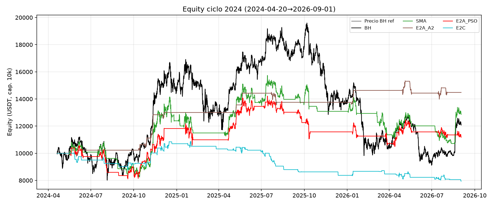

**Figura 4c.** Equity C24 (2024-04-20 → 2026-09-01): mercado lateral con corrección del −53 % en el BH;
solo E2-A A2 es rentable y estable.

### Comparativa visual por temporada (las 13 estrategias)

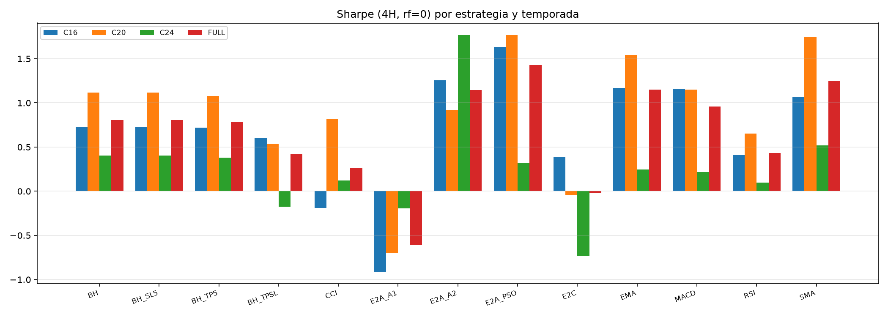

**Figura 5.** Sharpe por estrategia y temporada. Los seguidores de tendencia (SMA/EMA/MACD) dominan en
ciclos tendenciales (C16, C20) y se desinflan en el lateral (C24); **E2-A A2 es la única barra alta y
positiva en las cuatro ventanas**; el PSO brilla en C16/C20/FULL y se modera en C24; E2-A A1 nunca es
positiva.

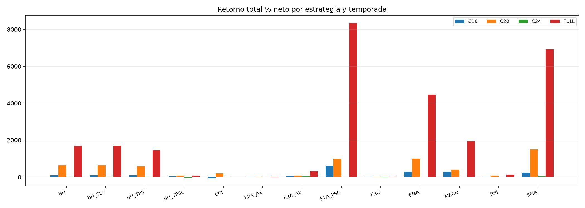

**Figura 6.** Retorno total % neto por estrategia y temporada (cada barra lleva implícita su ventana:
C16 = 2017-08-17 → 2020-05-10, C20 = 2020-05-11 → 2024-04-19, C24 = 2024-04-20 → 2026-09-01,
FULL = 2017-08-17 → 2026-09-01). El BH/SMA maximizan retorno absoluto a costa de riesgo extremo (Figura 7);
el TP 5 % siempre recorta vs BH puro.

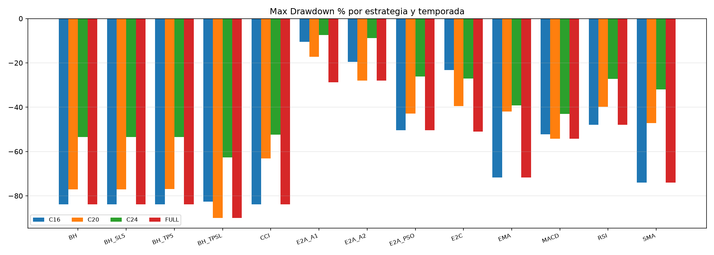

**Figura 7.** MaxDD % por estrategia y temporada. BH y TP/SL tocan −84 %/−90 %; E2-A A2 nunca supera −28 %
en ninguna ventana; E2-A A1, pese a perder, al menos cae poco (−7 %/−29 %).

---

## 5. Optimización — únicamente Enjambre de Partículas (PSO)

**En la v2 el único método de optimización es el PSO** (inteligencia de enjambre): una población de
partículas explora el espacio de parámetros de la arquitectura E2-A, combinando su mejor posición propia
con la mejor global del enjambre. No se usa ningún otro optimizador en esta versión.

- **Qué se optimiza:** 7 parámetros de E2-A (CCI periodo/entrada/salida, SMA rápida/lenta, ventana de
  volumen y umbral z). ATR fijado a 14/2.0 (sin efecto en el backtest actual a cierre de vela; el stop
  intra-vela queda como trabajo futuro).
- **Función objetivo:** Sharpe anualizado 4H en **IS70 (2017-08-17 → 2023-12-16)**, con penalización si la
  estrategia opera menos de 10 veces (evita soluciones degeneradas casi sin trades) y descarte de
  combinaciones inválidas (entrada ≥ salida).
- **Configuración:** 12 partículas × 20 iteraciones = 240 backtests + referencia inicial (la partícula 0
  parte de E2-A A2, lo que garantiza PSO ≥ A2 en IS), semilla 42, inercia 0.72, coeficientes 1.49.
- **Coste:** ~0.06 s por backtest → convergencia en segundos (ver Figura 8).

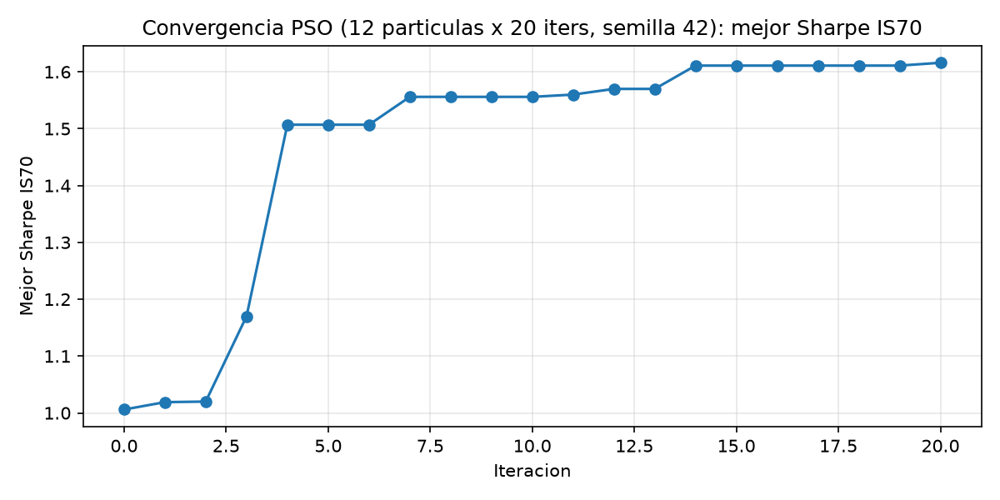

**Figura 8.** Convergencia PSO (mejor Sharpe IS70 por iteración, semilla 42): de 1.006 (A2) a 1.616.

| Parámetro | E2-A A2 (referencia) | **E2-A PSO (v2)** |
|---|---|---|
| CCI periodo / entrada / salida | 58 / −3 / 186 | **10 / 50 / 250** |
| SMA rápida / lenta | 18 / 221 | **27 / 227** |
| Volumen ventana / umbral z | 40 / 0.58 | **60 / 0.14** |
| Sharpe IS70 (2017-08-17 → 2023-12-16) | 1.006 | **1.616** |

**Lectura del PSO.** El enjambre empuja el CCI a ventanas cortas (10) con umbrales altos (50/250: solo
impulsos fuertes de momento) y la SMA lenta a ~227 (~38 días, región estable 220–230 ya vista en la SMA
aislada 228). El umbral de volumen baja a 0.14 (menos restrictivo). **Advertencia honesta:** cuatro
parámetros quedaron en bordes del espacio (periodo 10, entrada 50, salida 250, ventana 60), lo que indica
que el espacio debería expandirse en trabajo futuro; además el Sharpe cae de 1.616 en IS70 a 0.847 en
OOS30 (2023-12-17 → 2026-09-01): mejora real pero con sobreajuste parcial, por lo que la variante A2 se
conserva como referencia robusta.

---

## 6. Comparativa global riesgo–rendimiento y selección

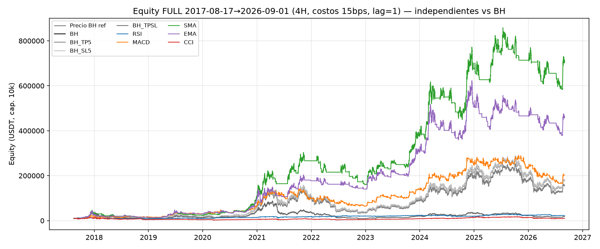

**Figura 9a.** Equity FULL de los independientes (2017-08-17 → 2026-09-01, capital 10 000 USDT, costos
incluidos). SMA y EMA se despegan en el bull 2020–2021; RSI/CCI quedan planos; BH+TP/SL se hunde por
sobreoperación (819 operaciones).

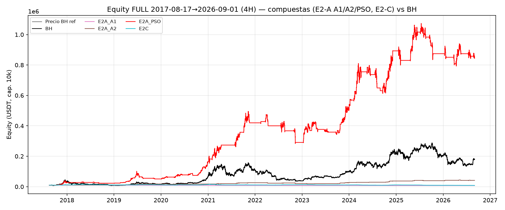

**Figura 9b.** Equity FULL de las compuestas frente al BH. E2-A PSO domina; E2-A A2 opera una fracción
pequeña del tiempo (exposición 9 %) con caídas 3× menores; E2-A A1 y E2-C pierden.

### Tabla 6a. Periodo FULL — independientes (2017-08-17 → 2026-09-01, 19 800 velas)

| Estrategia | Equity final | Retorno | CAGR | Sharpe | MaxDD | Calmar | Win rate | P. factor | Trades | Expos. |
|---|---:|---:|---:|---:|---:|---:|---:|---:|---:|---:|
| SMA | 702 396 | +6 923.96 % | 60.05 % | 1.244 | −73.96 % | 0.812 | 51.41 % | 1.127 | 110 | 0.52 |
| EMA | 457 086 | +4 470.86 % | 52.62 % | 1.152 | −71.80 % | 0.733 | 50.79 % | 1.117 | 204 | 0.51 |
| MACD | 202 334 | +1 923.34 % | 39.46 % | 0.960 | −54.17 % | 0.729 | 49.70 % | 1.097 | 304 | 0.50 |
| BH | 177 759 | +1 677.59 % | 37.48 % | 0.808 | −83.91 % | 0.447 | 51.32 % | 1.059 | 1 | 1.00 |
| BH+SL 5 % | 178 541 | +1 685.41 % | 37.55 % | 0.808 | −83.91 % | 0.447 | 51.31 % | 1.059 | 6 | 1.00 |
| BH+TP 5 % | 155 409 | +1 454.09 % | 35.45 % | 0.786 | −83.91 % | 0.423 | 51.16 % | 1.057 | 55 | 1.00 |
| RSI | 23 080 | +130.80 % | 9.69 % | 0.432 | −47.95 % | 0.202 | 49.16 % | 1.069 | 164 | 0.21 |
| BH+TP/SL 5 % | 17 745 | +77.45 % | 6.55 % | 0.421 | −90.03 % | 0.073 | 49.11 % | 1.030 | 819 | 0.96 |
| CCI | 9 950 | −0.50 % | −0.06 % | 0.264 | −83.87 % | −0.001 | 50.60 % | 1.026 | 126 | 0.56 |

### Tabla 6b. Periodo FULL — compuestas (2017-08-17 → 2026-09-01, 19 800 velas)

| Estrategia | Equity final | Retorno | CAGR | Sharpe | MaxDD | Calmar | Win rate | P. factor | Trades | Expos. |
|---|---:|---:|---:|---:|---:|---:|---:|---:|---:|---:|
| **BH (benchmark)** | 177 759 | +1 677.59 % | 37.48 % | 0.808 | −83.91 % | 0.447 | 51.32 % | 1.059 | 1 | 1.00 |
| **E2-A PSO** | 845 133 | **+8 351.33 %** | 63.35 % | **1.426** | −50.34 % | 1.259 | 52.05 % | 1.173 | 73 | 0.38 |
| E2-A A2 | 41 621 | +316.21 % | 17.08 % | 1.144 | −27.93 % | 0.612 | 53.27 % | 1.277 | 39 | 0.09 |
| E2-C | 8 494 | −15.06 % | −1.79 % | −0.024 | −51.08 % | −0.035 | 42.31 % | 0.995 | 294 | 0.10 |
| E2-A A1 | 7 649 | −23.51 % | −2.92 % | −0.609 | −28.83 % | −0.101 | 35.93 % | 0.682 | 30 | 0.01 |

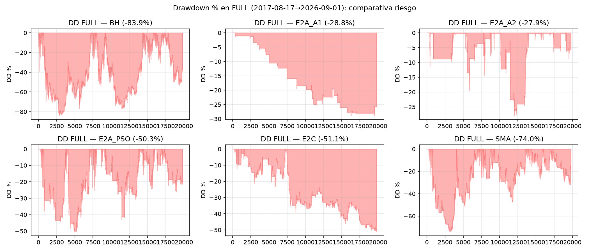

**Figura 10.** Drawdown % en FULL (2017-08-17 → 2026-09-01): BH (−83.91 %) y SMA (−73.96 %) pasan años bajo
el agua; E2-A PSO recorta a −50.34 % y E2-A A2 a −27.93 %; E2-A A1 cae poco pero porque casi no opera.

### 6.1 Lectura riesgo–rendimiento (con periodo siempre explícito)

1. **Rentabilidad absoluta FULL (2017-08-17 → 2026-09-01):** E2-A PSO (+8 351.33 %) > SMA (+6 923.96 %) >
   EMA (+4 470.86 %) > MACD (+1 923.34 %) > BH (+1 677.59 %) > E2-A A2 (+316.21 %) > RSI (+130.80 %) >
   BH+TP/SL (+77.45 %) > CCI (−0.50 %) > E2-C (−15.06 %) > E2-A A1 (−23.51 %).
2. **Riesgo FULL (2017-08-17 → 2026-09-01):** E2-A A2 (MaxDD −27.93 %, PF 1.277, el mayor del estudio) es la
   más contenida entre las rentables; E2-A PSO (MaxDD −50.34 %, Calmar 1.259, el mayor) duplica el drawdown
   pero lo compensa con CAGR 63.35 %; SMA (−73.96 %), EMA (−71.80 %) y BH (−83.91 %) son extremos; el TP/SL
   combinado toca −90.03 %.
3. **Robustez entre ciclos y forward (criterio decisivo):** E2-A A2 tiene Sharpe positivo y alto en las seis
   ventanas (C16 1.257, C20 0.920, C24 1.768, IS70 1.006, OOS30 1.816, FULL 1.144) con MaxDD siempre inferior
   a −28 %. E2-A PSO también es positiva en las seis (1.634, 1.770, 0.317, 1.616, 0.847, 1.426) pero se
   debilita en C24 (2024-04-20 → 2026-09-01) y OOS30 (2023-12-17 → 2026-09-01). Ninguna otra estrategia —ni
   el BH— combina positividad total con drawdown contenido.
4. **Costos y operatividad:** E2-A PSO ejecuta 73 operaciones en 9 años (~8/año) y E2-A A2 solo 39 (~4/año):
   los 15 bps por lado son irrelevantes y ambas son operables manualmente en 4H. La SMA (110), la EMA (204),
   el MACD (304) y E2-C (294) pagan 5–15× más costos; el TP/SL 5 % (819) se autodestruye en comisiones y
   latigazos.

### 6.2 Selección: mejor desempeño en riesgo–rendimiento

> **Se selecciona la estrategia E2-A optimizada por PSO (CCI + SMA + volumen, parámetros §5) como la de
> mejor desempeño global en riesgo–rendimiento: Sharpe FULL 1.426 y retorno +8 351.33 % entre 2017-08-17 y
> 2026-09-01, Calmar 1.259 (el mayor del estudio), positiva en las tres temporadas halving (Sharpe 1.634 en
> C16, 1.770 en C20 y 0.317 en C24) y rentable en el forward no visto (+68.68 % entre 2023-12-17 y 2026-09-01,
> Sharpe 0.847).**
> **Para perfiles conservadores se recomienda la variante E2-A A2**, que sacrifica retorno
> (+316.21 % entre 2017-08-17 y 2026-09-01, +60.71 % entre 2023-12-17 y 2026-09-01) a cambio de la máxima
> estabilidad (MaxDD −27.93 % en FULL y −8.82 % en OOS30, Sharpe forward 1.816, profit factor 1.484, el mayor
> del estudio).
> La SMA queda como mejor independiente (+6 923.96 % entre 2017-08-17 y 2026-09-01, Sharpe 1.244) para
> perfiles tolerantes a drawdowns de −74 %; el Buy & Hold queda como benchmark superado en Sharpe (0.808) y
> en drawdown por ambas E2-A; E2-C (−15.06 %), E2-A A1 (−23.51 %) y el CCI (−0.50 % entre 2017-08-17 y
> 2026-09-01) se descartan.

Esta selección responde a los objetivos 2 y 3 (selección por riesgo–rendimiento y evaluación por backtest
70 % + forward 30 % en distintos regímenes) y al objetivo 4 (optimización exclusivamente por PSO con
validación out-of-sample y reporte honesto de degradación parcial).
