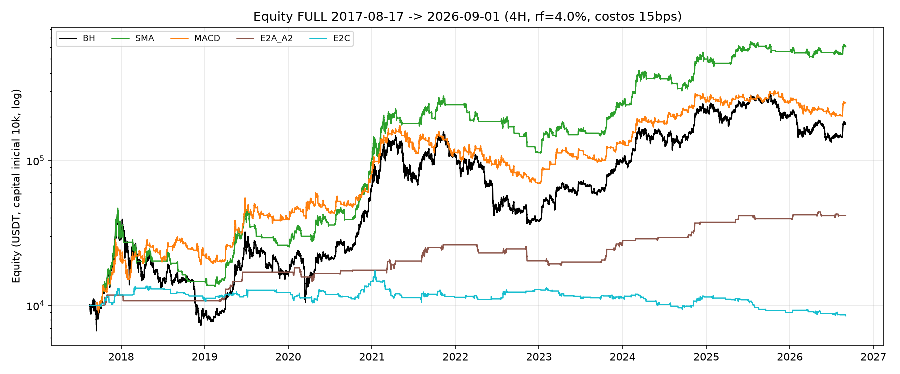
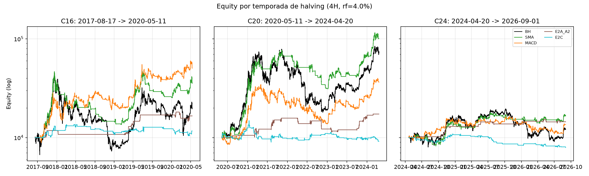
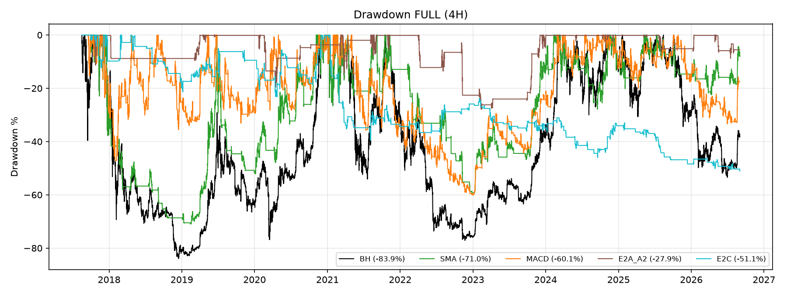
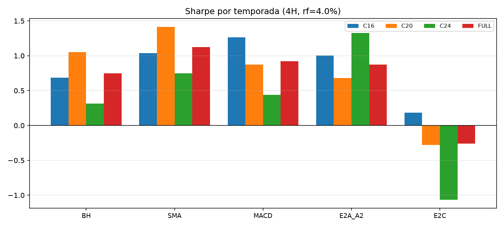
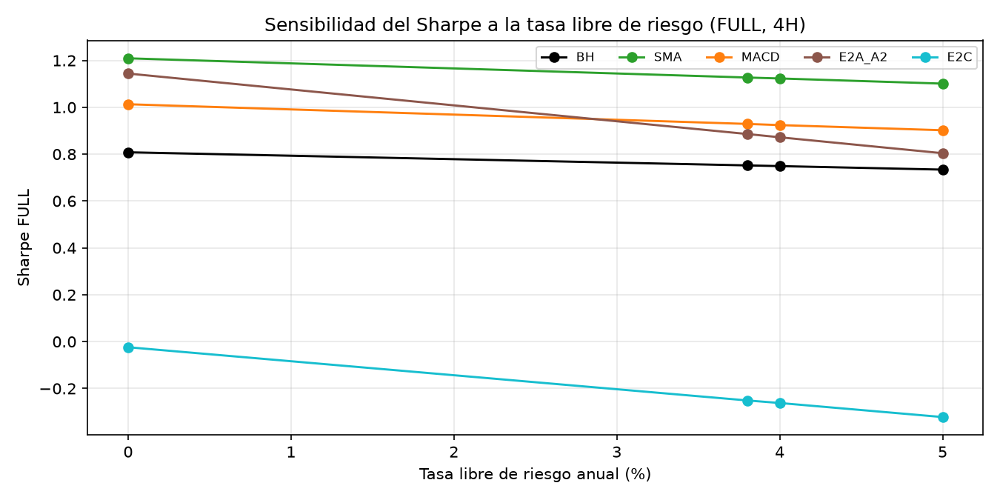

# Capítulo de Resultados — Estrategias de Trading BTC/USDT

**Trabajo de grado — Ingeniería Financiera, UNAB**

**Versión 3 normalizada — 8 de noviembre de 2026**

> Versión vigente: v3 normalizada. Todo el análisis se calcula en velas de 4 horas, el Sharpe usa una tasa libre de riesgo del 4,00% anual, las métricas de acierto son por operación y se eliminaron el Sortino y el stop ATR. Los parámetros se seleccionaron con un único protocolo: TPE con mediana del Sharpe fuera de muestra, rf = 4% y warmup global.
>
> **Recomendación:** E2-A A2 para el perfil conservador de esta tesis. La SMA se reporta como alternativa agresiva.

---

## 1. Metodología

### 1.1 Datos y temporalidad

Se utilizan klines de Binance Spot para BTC/USDT desde el 17 de agosto de 2017 hasta el 1 de septiembre de 2026. La serie de análisis es de **4 horas**: 19.800 velas. La serie de 1 minuto se conserva únicamente como fuente para reconstruir la de 4 horas.

La frecuencia de 4 horas es la frecuencia de decisión de la estrategia y la que opera el bot. Calcular el Sharpe sobre retornos de 1 minuto de una posición que solo cambia cada 4 horas mide ruido de microestructura que nunca se opera. Con una sola temporalidad hay un solo número de periodos por año, lo que elimina el riesgo de mezclar escalas.

### 1.2 Retorno, costos y equity

```
r_t        = close_t / close_{t-1} - 1
posición_t = señal_{t-1}                 (lag = 1, sin look-ahead)
bruto_t    = posición_t * r_t
costo_t    = |posición_t - posición_{t-1}| * (fee + slippage)
ret_neto_t = bruto_t - costo_t
equity_t   = 10.000 * producto(1 + ret_neto_t)
```

Los costos son 10 puntos base de fee taker más 5 puntos base de slippage por lado (15 pb), cobrados solo en la vela en que cambia la posición. El CAGR se calcula como `(equity_final / equity_inicial)^(1/años) - 1`, con `años = n_velas / 2.190`.

### 1.3 Ratio de Sharpe

```
Rf_vela  = rf_anual / P
exceso_t = ret_neto_t - Rf_vela
Sharpe   = media(exceso) / desviación_estándar(exceso, ddof=1) * raíz(P)
```

- `rf_anual = 0,04` (4,00%). En agosto de 2026, inicio del proyecto, la T-Bill a 3 meses de EE.UU. promedió alrededor de 3,80% anual; se adopta 4,00% por ser un número redondo y ligeramente conservador.
- `P = 2.190` velas por año para 4 horas (365 días × 24 horas / 4).
- `P` se deduce del espaciado mediano entre timestamps; no se escribe a mano.
- La tasa es obligatoria en el código: no existe un `rf = 0` implícito.
- Como `Rf` es constante, la desviación estándar del exceso es igual a la del retorno bruto.

### 1.4 Métricas por operación

Una operación va desde la entrada (posición 0 a 1) hasta la salida (1 a 0), incluyendo el costo de salida:

- **Win rate:** operaciones ganadoras sobre operaciones totales.
- **Profit factor:** suma de ganancias sobre valor absoluto de las pérdidas. Si no hay pérdidas se reporta como guion.
- **Retorno medio por operación** y **duración media** en velas.

No se reportan métricas de acierto por vela: con cerca del 91% de velas planas en E2-A, el win rate por vela subestima el desempeño real.

### 1.5 Protocolo único de selección

Las seis estrategias parametrizables (los cinco indicadores y E2-A A2) se seleccionaron con el **mismo protocolo**:

- **Optimizador:** TPE (Optuna), 100 trials por estrategia.
- **Folds walk-forward:** test 2021, 2022, 2023 y 2024. En cada fold, el candidato se evalúa en un año que no participó de su calibración.
- **Objetivo:** **mediana del Sharpe OOS entre los cuatro folds**, con rf = 4%.
- **Warmup global:** los indicadores se calculan sobre toda la historia y luego se recorta el fold. Así el inicio de cada año no pierde la historia previa.
- **Regla de validez:** un fold es válido si tiene exposición mayor o igual a 0,5%, al menos 5 operaciones, no pierde con profit factor menor a 1 y su drawdown no supera el 50%. Si es inválido, puntúa -5,0.
- **Holdout:** 2025-01-01 a 2026-09-01, nunca usado en la selección.

La semilla es 42 y el TPE arranca desde la selección anterior. Ese warm start garantiza que la re-optimización no pueda quedar peor que el punto de partida en su propio objetivo.

### 1.6 Decisiones metodológicas

- **Se eliminó el Sortino.** No se usaba para decidir y su definición generaba ambigüedad.
- **Se eliminó el stop ATR.** El ATR viajaba en los parámetros pero ningún backtest lo aplicaba. E2-A es una señal 0/1 pura de CCI, SMA y volumen.
- **Se excluyeron las variantes PSO y los overlays TP/SL del universo principal.** Los TP/SL son variantes de riesgo del mismo benchmark, no estrategias distintas; el PSO usaba otro protocolo. Ambos quedan como anexo.

---

## 2. Universo normalizado

Se comparan nueve estrategias, todas long-only (0/1):

| Estrategia | Tipo | Origen de parámetros | Protocolo de selección |
|---|---|---|---|
| Buy & Hold | Benchmark | — | — |
| RSI | Individual | TPE 100 trials | Mediana Sharpe OOS + holdout |
| MACD | Individual | TPE 100 trials | Mediana Sharpe OOS + holdout |
| SMA | Individual | TPE 100 trials | Mediana Sharpe OOS + holdout |
| EMA | Individual | TPE 100 trials | Mediana Sharpe OOS + holdout |
| CCI | Individual | TPE 100 trials | Mediana Sharpe OOS + holdout |
| E2-A A1 | Compuesta | Paper (fijos) | Sin optimización |
| E2-A A2 | Compuesta | TPE 100 trials | Mediana Sharpe OOS + holdout |
| E2-C | Compuesta | Fijos (ganadoras etapa 1) | Sin optimización |

Las tres estrategias fijas cumplen un rol de control: A1 reproduce el paper, E2-C combina las ganadoras de la etapa 1 con parámetros fijos y Buy & Hold es el benchmark.

---

## 3. Resultados del periodo completo

Tabla 1. Desempeño en el periodo completo (2017-08-17 a 2026-09-01), 4H, Sharpe con rf = 4%, costos de 15 pb y métricas de acierto por operación.

| Estrategia | Equity final | Retorno | CAGR | Sharpe | MaxDD | Calmar | Trades | Win rate | PF |
|---|---:|---:|---:|---:|---:|---:|---:|---:|---:|
| SMA | 606 889 | 5 968.9 % | 57.48 % | 1.123 | -70.96 % | 0.810 | 66 | 33.33 % | 4.41 |
| EMA | 477 716 | 4 677.2 % | 53.37 % | 1.065 | -66.72 % | 0.800 | 57 | 35.09 % | 3.68 |
| MACD | 249 343 | 2 393.4 % | 42.72 % | 0.924 | -60.05 % | 0.711 | 285 | 37.19 % | 1.73 |
| E2A_A2 | 41 621 | 316.2 % | 17.08 % | 0.872 | -27.93 % | 0.612 | 39 | 76.92 % | 3.17 |
| BH | 177 759 | 1 677.6 % | 37.48 % | 0.749 | -83.91 % | 0.447 | 1 | 100.00 % | — |
| CCI | 12 943 | 29.4 % | 2.89 % | 0.248 | -87.04 % | 0.033 | 118 | 75.42 % | 1.29 |
| RSI | 16 217 | 62.2 % | 5.49 % | 0.209 | -57.43 % | 0.096 | 361 | 69.25 % | 1.22 |
| E2C | 8 494 | -15.1 % | -1.79 % | -0.262 | -51.08 % | -0.035 | 294 | 35.03 % | 0.99 |
| E2A_A1 | 7 649 | -23.5 % | -2.92 % | -1.463 | -28.83 % | -0.101 | 30 | 23.33 % | 0.34 |

La lectura no es unidimensional:

- **Mejor Sharpe y mejor Calmar:** SMA (1,123 y 0,810), seguida por EMA y MACD. Los seguidores de tendencia capturan el drift alcista secular de Bitcoin.
- **Menor drawdown entre las rentables:** E2-A A2 (-27,93%), frente al -70,96% de la SMA y el -83,91% del Buy & Hold.
- **Mejor win rate:** E2-A A2 (76,92%), con 39 operaciones en nueve años.
- **Las compuestas no dominan:** E2-A A1 pierde (-23,5%) y E2-C pierde (-15,1%). Combinar indicadores no garantiza un buen sistema.

No hay dominancia: la SMA gana en Sharpe y Calmar, pero con un drawdown de -71%; A2 gana en drawdown, win rate y comportamiento forward. **La recomendación de esta tesis es E2-A A2** (ver §10): el criterio de riesgo prioriza la protección del capital. La SMA queda como alternativa agresiva.

---

## 4. Robustez por temporadas de halving

Se dividen los datos en los tres ciclos de halving: C16 (2017-08-17 a 2020-05-11), C20 (2020-05-11 a 2024-04-20) y C24 (2024-04-20 a 2026-09-01).

Tabla 2. Ciclo C16 (2017-2020).

| Estrategia | Equity final | Retorno | CAGR | Sharpe | MaxDD | Calmar | Trades | Win rate | PF |
|---|---:|---:|---:|---:|---:|---:|---:|---:|---:|
| BH | 20 023 | 100.2 % | 29.01 % | 0.684 | -83.91 % | 0.346 | 1 | 100.00 % | — |
| SMA | 36 245 | 262.4 % | 60.38 % | 1.036 | -70.96 % | 0.851 | 19 | 31.58 % | 3.76 |
| MACD | 50 398 | 404.0 % | 81.00 % | 1.265 | -47.08 % | 1.720 | 79 | 41.77 % | 2.05 |
| E2A_A2 | 16 588 | 65.9 % | 20.40 % | 1.003 | -19.60 % | 1.041 | 9 | 77.78 % | 3.59 |
| E2C | 11 676 | 16.8 % | 5.85 % | 0.184 | -23.18 % | 0.252 | 88 | 40.91 % | 1.20 |

Tabla 3. Ciclo C20 (2020-2024).

| Estrategia | Equity final | Retorno | CAGR | Sharpe | MaxDD | Calmar | Trades | Win rate | PF |
|---|---:|---:|---:|---:|---:|---:|---:|---:|---:|
| BH | 73 272 | 632.7 % | 65.67 % | 1.052 | -77.04 % | 0.852 | 1 | 100.00 % | — |
| SMA | 101 262 | 912.6 % | 79.83 % | 1.413 | -59.48 % | 1.342 | 29 | 37.93 % | 5.82 |
| MACD | 36 371 | 263.7 % | 38.72 % | 0.874 | -60.05 % | 0.645 | 135 | 33.33 % | 1.63 |
| E2A_A2 | 17 326 | 73.3 % | 14.95 % | 0.680 | -27.93 % | 0.535 | 17 | 76.47 % | 2.63 |
| E2C | 9 164 | -8.4 % | -2.19 % | -0.279 | -39.54 % | -0.055 | 134 | 35.07 % | 0.98 |

Tabla 4. Ciclo C24 (2024-2026).

| Estrategia | Equity final | Retorno | CAGR | Sharpe | MaxDD | Calmar | Trades | Win rate | PF |
|---|---:|---:|---:|---:|---:|---:|---:|---:|---:|
| BH | 12 090 | 20.9 % | 8.34 % | 0.316 | -53.45 % | 0.156 | 1 | 100.00 % | — |
| SMA | 16 560 | 65.6 % | 23.72 % | 0.749 | -23.95 % | 0.990 | 19 | 31.58 % | 2.58 |
| MACD | 13 553 | 35.5 % | 13.69 % | 0.440 | -33.38 % | 0.410 | 72 | 40.28 % | 1.36 |
| E2A_A2 | 14 482 | 44.8 % | 16.91 % | 1.327 | -8.82 % | 1.918 | 13 | 76.92 % | 4.11 |
| E2C | 7 938 | -20.6 % | -9.28 % | -1.063 | -27.05 % | -0.343 | 72 | 27.78 % | 0.72 |

En C24, el ciclo lateral, E2-A A2 es la única estrategia con Sharpe alto (1,327) y drawdown de un dígito (-8,82%). La SMA y el MACD se desinflan, y E2-C pierde dinero.

Tabla 5. Robustez: peor Sharpe entre las seis ventanas evaluadas (C16, C20, C24, IS70, OOS30 y FULL).

| Estrategia | Peor Sharpe | Sharpe FULL |
|---|---:|---:|
| SMA | 0.749 | 1.123 |
| E2A_A2 | 0.680 | 0.872 |
| EMA | 0.544 | 1.065 |
| MACD | 0.440 | 0.924 |
| BH | 0.316 | 0.749 |
| CCI | -0.308 | 0.248 |
| RSI | -0.853 | 0.209 |
| E2C | -1.063 | -0.262 |
| E2A_A1 | -2.162 | -1.463 |

Dos estrategias tienen un peor caso positivo superior a 0,6: SMA (0,749) y E2-A A2 (0,680). La SMA gana por poco en el peor Sharpe, pero con un drawdown de -71% frente al -28% de A2.

---

## 5. In-sample versus out-of-sample

Se separa el 70% inicial como in-sample (IS70: 2017-08-17 a 2023-12-16) y el 30% final como forward no visto (OOS30: 2023-12-17 a 2026-09-01).

Tabla 6. IS70 (in-sample).

| Estrategia | Equity final | Retorno | CAGR | Sharpe | MaxDD | Calmar | Trades | Win rate | PF |
|---|---:|---:|---:|---:|---:|---:|---:|---:|---:|
| BH | 97 048 | 870.5 % | 43.20 % | 0.800 | -83.91 % | 0.515 | 1 | 100.00 % | — |
| SMA | 239 729 | 2 297.3 % | 65.20 % | 1.154 | -70.96 % | 0.919 | 44 | 31.82 % | 4.55 |
| MACD | 131 704 | 1 217.0 % | 50.28 % | 0.986 | -60.05 % | 0.837 | 202 | 36.63 % | 1.75 |
| E2A_A2 | 26 076 | 160.8 % | 16.35 % | 0.762 | -27.93 % | 0.585 | 25 | 72.00 % | 2.77 |
| E2C | 11 243 | 12.4 % | 1.87 % | -0.027 | -39.54 % | 0.047 | 205 | 37.56 % | 1.09 |

Tabla 7. OOS30 (forward no visto).

| Estrategia | Equity final | Retorno | CAGR | Sharpe | MaxDD | Calmar | Trades | Win rate | PF |
|---|---:|---:|---:|---:|---:|---:|---:|---:|---:|
| BH | 18 443 | 84.4 % | 25.32 % | 0.631 | -53.45 % | 0.474 | 1 | 100.00 % | — |
| SMA | 25 490 | 154.9 % | 41.20 % | 1.119 | -27.85 % | 1.479 | 23 | 39.13 % | 3.77 |
| MACD | 18 932 | 89.3 % | 26.53 % | 0.773 | -33.38 % | 0.795 | 83 | 38.55 % | 1.64 |
| E2A_A2 | 16 071 | 60.7 % | 19.12 % | 1.412 | -8.82 % | 2.168 | 15 | 80.00 % | 4.96 |
| E2C | 7 555 | -24.4 % | -9.82 % | -1.057 | -29.09 % | -0.338 | 89 | 29.21 % | 0.73 |

Tres resultados importan:

1. **SMA mejora fuera de muestra:** pasa de 1,154 en IS70 a 1,119 en OOS30, con drawdown de -27,85%. Su versión re-seleccionada con rf = 4% es más estable que la anterior.
2. **E2-A A2 también mejora:** de 0,762 a 1,412, con el mismo drawdown de -8,82% y 80% de win rate en el forward.
3. **E2-C pierde en ambos:** -0,027 en IS70 y -1,057 en OOS30. Confirma que combinar ganadoras no basta.

---

## 6. Re-selección con la métrica oficial

### 6.1 Re-selección TPE con rf = 4%

Para alinear la selección con la métrica oficial, se repitió el TPE de las seis estrategias parametrizables con el objetivo: mediana del Sharpe OOS entre los folds 2021-2024, rf = 4%, warmup global y 100 trials por estrategia.

Tabla 8. Parámetros previos versus selección v3, evaluados bajo el mismo protocolo. Las columnas "previo" y "v3" son dos juegos de parámetros, no dos tipos de pronóstico: ambos se evalúan en los mismos folds (2021-2024) y en el mismo holdout (2025-2026).

| Estrategia | Mediana OOS previa | Mediana OOS v3 | Holdout previo | Holdout v3 | FULL previo | FULL v3 |
|---|---:|---:|---:|---:|---:|---:|
| RSI | 0.519 | 1.036 | 0.353 | -0.662 | 0.325 | 0.209 |
| MACD | 1.266 | 1.337 | -0.393 | -0.009 | 0.872 | 0.924 |
| SMA | 1.567 | 1.729 | 0.053 | 0.435 | 1.158 | 1.123 |
| EMA | 1.260 | 1.606 | -0.294 | 0.121 | 1.065 | 1.065 |
| CCI | 0.935 | 0.988 | -0.453 | -0.268 | 0.189 | 0.248 |
| E2A_A2 | 1.567 | 1.567 | 0.339 | 0.339 | 0.872 | 0.872 |

Lectura:

- **E2-A A2 no cambia.** El TPE con rf = 4% devuelve exactamente los mismos parámetros que la selección anterior. La estrategia recomendada es estable frente al cambio de métrica.
- **SMA mejora en las tres dimensiones:** mediana (1,567 a 1,729), holdout (0,053 a 0,435) y se mantiene en FULL (1,158 a 1,123, prácticamente igual).
- **EMA, MACD y CCI mejoran el holdout**, aunque MACD y CCI siguen negativos fuera de muestra.
- **RSI empeora:** mejora la mediana de los folds pero su holdout cae de 0,353 a -0,662. Es el caso típico de sobreajuste a los folds de validación.

> **Nota metodológica:** también se probó una variante PSO con un split único; sobreajustó y no forma parte del universo. La lección es general: optimizar sobre una sola ventana in-sample no garantiza generalizar.

---

## 7. Sensibilidad a la tasa libre de riesgo

Tabla 9. Sharpe FULL para distintas tasas libres de riesgo.

| Estrategia | rf = 0% | rf = 3,8% | rf = 4% | rf = 5% |
|---|---:|---:|---:|---:|
| BH | 0.808 | 0.752 | 0.749 | 0.734 |
| RSI | 0.328 | 0.214 | 0.209 | 0.179 |
| MACD | 1.013 | 0.929 | 0.924 | 0.902 |
| SMA | 1.209 | 1.127 | 1.123 | 1.101 |
| EMA | 1.151 | 1.069 | 1.065 | 1.044 |
| CCI | 0.322 | 0.251 | 0.248 | 0.229 |
| E2A_A1 | -0.609 | -1.421 | -1.463 | -1.677 |
| E2A_A2 | 1.144 | 0.886 | 0.872 | 0.804 |
| E2C | -0.024 | -0.251 | -0.262 | -0.322 |

La conclusión es estable en todo el rango: SMA y EMA superan al Buy & Hold en Sharpe con cualquier tasa entre 0% y 5%, y E2-A A2 también lo supera (0,804 frente a 0,734 con rf = 5%).

La tasa afecta más a las estrategias con baja exposición, porque el costo de oportunidad se resta en todas las velas: A2, invertida solo el 9,3% del tiempo, pierde 0,340 de Sharpe entre rf = 0% y rf = 5%, mientras que el Buy & Hold pierde 0,074.

---

## 8. Métricas por operación

Tabla 10. Operaciones en el periodo completo.

| Estrategia | Trades | Win rate | Profit factor | Retorno medio | Duración media (velas) | Exposición |
|---|---:|---:|---:|---:|---:|---:|
| BH | 1 | 100.00 % | — | 1 677.59 % | 19 799.0 | 99.99 % |
| RSI | 361 | 69.25 % | 1.22 | 0.20 % | 12.7 | 23.08 % |
| MACD | 285 | 37.19 % | 1.73 | 1.49 % | 35.1 | 50.59 % |
| SMA | 66 | 33.33 % | 4.41 | 13.23 % | 155.3 | 51.76 % |
| EMA | 57 | 35.09 % | 3.68 | 12.26 % | 179.7 | 51.74 % |
| CCI | 118 | 75.42 % | 1.29 | 0.94 % | 95.9 | 57.16 % |
| E2A_A1 | 30 | 23.33 % | 0.34 | -0.87 % | 6.7 | 1.02 % |
| E2A_A2 | 39 | 76.92 % | 3.17 | 4.11 % | 47.2 | 9.29 % |
| E2C | 294 | 35.03 % | 0.99 | -0.01 % | 6.7 | 9.88 % |

El Buy & Hold tiene una sola operación, por eso su win rate es 100% y su profit factor se reporta como guion (no es infinito). Las comparaciones de win rate y profit factor deben hacerse entre estrategias con múltiples operaciones.

E2-A A2 ejecuta 39 operaciones en nueve años (unas 4,3 por año), gana el 76,92% y obtiene un profit factor de 3,17. La SMA ejecuta 66 operaciones, gana solo el 33,33%, pero su profit factor es 4,41 porque sus ganancias son mucho más grandes que sus pérdidas. Son dos perfiles distintos: A2 acierta más; SMA gana más por acierto.

---

## 9. Figuras











---

## 10. Conclusiones

1. **E2-A A2 es la estrategia recomendada por esta tesis.** Con rf = 4% obtiene Sharpe 0,872, CAGR 17,08%, MaxDD -27,93%, Calmar 0,612, win rate 76,92% y profit factor 3,17. Es la mejor en drawdown y consistencia, y la mejor en el forward OOS30 (1,412). Su peor Sharpe entre seis ventanas es 0,680, segundo mejor de las nueve estrategias.

2. **La SMA es la mejor alternativa agresiva.** Lidera Sharpe (1,123), Calmar (0,810) y peor caso (0,749), con un CAGR de 57,48%. Pero su drawdown es -70,96%, 2,5 veces el de A2. Es apta para un inversor con alta tolerancia al riesgo y horizonte largo; no para el perfil conservador de esta tesis.

3. **La recomendación se basa en el criterio de riesgo, no en el Sharpe máximo.** Si se optimizara solo Sharpe, ganaría SMA. La tesis prioriza la protección del capital: un drawdown de -71% exige una tolerancia y un horizonte que no son los del perfil analizado. A2 reduce el drawdown a menos de la mitad (-70,96% a -27,93%) a cambio de un CAGR menor (17,08% frente a 57,48%).

4. **La re-selección con rf = 4% valida a A2:** el TPE devuelve exactamente los mismos parámetros. La estrategia recomendada no depende de que la tasa haya sido 0% en la etapa de selección.

5. **Re-optimizar no garantiza generalizar:** una variante optimizada con un solo split mejoró el in-sample y colapsó fuera de muestra. El RSI re-seleccionado también empeoró su holdout. La selección walk-forward con holdout es más importante que el algoritmo.

6. **Las compuestas no dominan:** E2-A A1 (-23,5%) y E2-C (-15,1%) pierden dinero. Combinar indicadores con buenos parámetros individuales no produce automáticamente un buen sistema.

> **Recomendación final:** E2-A A2 para el perfil conservador de esta tesis (drawdown de -27,93%, win rate de 76,92%, forward 1,412). La SMA queda como alternativa agresiva para perfiles con mayor tolerancia al drawdown.

### Limitaciones

- E2-A A2 ejecuta solo 39 operaciones en nueve años: la inferencia estadística sobre win rate y profit factor es limitada.
- El análisis es a cierre de vela de 4 horas; no se modelan stops intra-vela ni impacto de mercado.
- El TPE explota en algunos casos los bordes del espacio de búsqueda (CCI salida en 150 para el nuevo CCI, SMA lenta en 247). Ampliar los rangos y validar con walk-forward queda como trabajo futuro.
- El bot opera en Binance Demo, no en producción.

---

## Anexo. Reproducción

```
python scripts/run_tpe_v3.py              # re-seleccion TPE con rf = 4%
python scripts/run_resultados.py          # tablas y figuras v3 normalizadas
python scripts/md_to_pdf_v3.py            # este documento en PDF
```

Cada corrida de `run_resultados.py` escribe `manifest.json` con el commit de git, el hash de la configuración, el timeframe, el número de periodos por año, la tasa libre de riesgo, los costos, el lag, el universo y el protocolo de selección. Los parámetros seleccionados viven en `configs/strategies.yaml` (bloque `v3_selection`) y el detalle de la re-selección está en `docs/tesis_resultados_v3/tablas/tpe_v3.json`.
